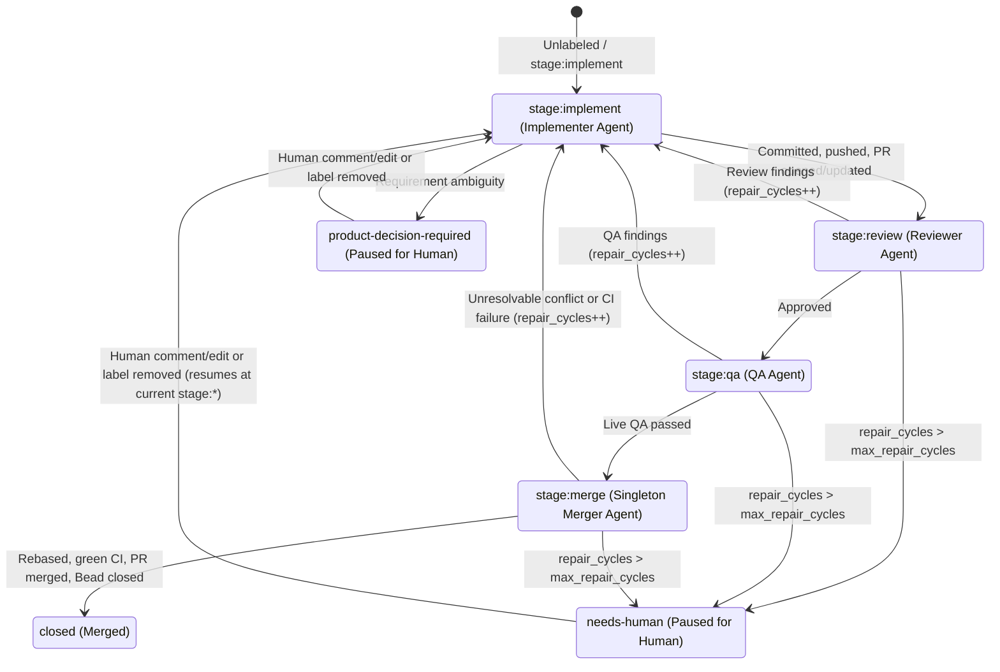

# Nightweaver Architecture Specification

Nightweaver is a standalone, discovery-driven autonomous software factory. Operated against an external **Target Repository** via a named **Project** configuration, the **Orchestrator** monitors a Beads (`bd`) issue tracker, dispatches scoped **Agents** through headless **Agent CLI** processes to plan user-authored **Product Beads** into independently deployable **Plan Beads** (or defer under-specified ones back to humans for clarification), drives those **Plan Beads** through implementation, static review, live QA verification, and serialized merge inside isolated Git worktrees, and deterministically cleans up its execution environment.

Relevant domain vocabulary is defined in [`GLOSSARY.md`](./GLOSSARY.md). Architectural trade-offs are recorded in:
- [ADR 0001: Two-tier Product and Plan Beads](./docs/adr/0001-two-tier-product-and-plan-beads.md)
- [ADR 0002: Beads-native Agent handoff and thin Orchestrator](./docs/adr/0002-beads-native-agent-handoff-and-thin-orchestrator.md)

---

## 1. Architectural Principles & Authority Boundary

1. **Two-Tier Bead Lifecycle (`Product Bead` -> `Plan Bead`)**:
   - **Product Beads** (`--type feature` or `--type bug`) are human-authored Beads describing user-level product requirements or bug reports that enter **Planning**.
   - **Plan Beads** (`--type task`) are Planner-authored (or human-authored) Beads containing a self-contained technical implementation specification ready for **Delivery**, linked to their parent **Product Bead** via `--deps discovered-from:<product-bead-id>`.
   - Every **Plan Bead** slice must be **independently deployable** to `default_branch`. When multiple **Plan Beads** require sequencing, the **Planner Agent** wires native `blocks` dependencies (`bd dep add <later-slice> <earlier-slice>`) between them so `bd ready` enforces ordering automatically.

2. **Beads-Native Workflow State**:
   - All workflow state, stage transitions (`stage:*` labels), human escalation states (`product-decision-required`, `needs-human`), repair cycle counters (`repair_cycles` metadata), and inter-agent findings live directly on the **Product Bead** and **Plan Bead** in `bd`.
   - Nightweaver maintains no separate database or local JSON state store and does not use `bd formula` sub-bead molecules.

3. **Thin, Crash-Stateless Orchestrator vs. Autonomous Tool-Using Agents**:
   - **Orchestrator responsibilities**:
     - Watch `bd` mutations in the **Target Repository** via `bd events tail --follow`.
     - Claim eligible Beads (`bd update <id> --claim`) and schedule them across three bounded concurrency pools (**Planning**, **Delivery**, and singleton **Merger**).
     - Provision, reset, and clean up isolated Git worktrees, per-invocation temporary directories, and **Win32 Job Objects**.
     - Map each Bead's `(type, stage:* label)` to its corresponding **Agent** role and launch the configured **Agent CLI**.
     - Verify post-exit invariants (process exit code `0`, clean worktree via `git status --porcelain`, and a legal `bd` state transition for that role), manage operational retries and semantic repair budgets, and auto-close `planned` **Product Beads** once all their `discovered-from` **Plan Beads** reach `closed`.
   - **Agent responsibilities**:
     - Each **Agent** executes directly inside the Bead's isolated worktree with full CLI/tool autonomy within its role mandate (`bd`, `git`, `gh`, and the **Target Repository**'s build/test toolchain).
     - Each **Agent** reads its assigned Bead via `bd show <id>` and `bd comments <id>`, performs its single lifecycle responsibility, records findings or summaries via `bd comments add`, and transitions the Bead's `stage:*` or lifecycle label in `bd` before exiting.

4. **Zero-Footprint Target Repository Boundary**:
   - Nightweaver stores all **Project** configurations, worktrees, logs, and temporary directories inside the Nightweaver host directory (`<nightweaver-root>/`), leaving zero Nightweaver-specific files inside the **Target Repository**.
   - Repository-specific build, test, QA, architecture, and non-default merge conventions live in the **Target Repository**'s checked-in `AGENTS.md` / `CLAUDE.md`, `GLOSSARY.md`, `docs/adr/`, and repository skills, which the **Agent CLI** loads natively from the worktree.

---

## 2. Bead Lifecycle, States, and Human Handoff Protocol

### 2.1 Planning Lifecycle (`Product Bead`: `--type feature,bug`)

```mermaid
stateDiagram-v2
    [*] --> StagePlan: Unlabeled / stage:plan
    StagePlan: stage:plan (Planner Agent)
    StagePlanChallenge: stage:plan-challenge (Plan Challenger Agent)
    StagePlanApproved: stage:plan-approved (Planner Agent)
    ProductDecision: product-decision-required (Paused for Human)
    NeedsHuman: needs-human (Paused for Human)
    Planned: planned (Awaiting Plan Beads Delivery)
    Closed: closed

    StagePlan --> ProductDecision: Under-specified / ambiguity
    ProductDecision --> StagePlan: Human comment/edit or label removed
    StagePlan --> StagePlanChallenge: Draft decomposition posted in comments
    StagePlanChallenge --> StagePlan: Revision findings (repair_cycles++)
    StagePlanChallenge --> NeedsHuman: repair_cycles > max_repair_cycles
    StagePlanChallenge --> StagePlanApproved: Decomposition approved
    StagePlanApproved --> Planned: Plan Beads (--type task) created & linked
    Planned --> Closed: All discovered-from Plan Beads closed
```



1. **Discovery & Eligibility**:
   - Unblocked, unassigned **Product Beads** (`bd ready --type feature,bug --unassigned`) that do not carry `planned`, `product-decision-required`, or `needs-human` are eligible for **Planning** (subject to `max_active_plan_beads` backpressure; see Section 5.2).
2. **Drafting & Clarification (`stage:plan`)**:
   - The **Planner Agent** evaluates the **Product Bead** (full description and comment history) against the codebase inside a detached-`HEAD` worktree at `origin/<default_branch>`.
   - **Clarification Deferral (`product-decision-required`)**: If product requirements are ambiguous or contradictory, the **Planner Agent** posts a structured clarification comment via `bd comments add <id>` and applies `product-decision-required`.
   - **Candidate Decomposition (`stage:plan-challenge`)**: Once requirements are clear, the **Planner Agent** posts a candidate decomposition of 1:N independently deployable **Plan Beads** (including proposed `blocks` edges and each slice's specification) as a structured comment on the **Product Bead** and transitions its label to `stage:plan-challenge`. No `--type task` **Plan Beads** are created in `bd` yet.
3. **Adversarial Plan Critique (`stage:plan-challenge`)**:
   - The **Plan Challenger Agent** independently critiques the drafted decomposition against the **Product Bead** and codebase (checking slice independence, deployability, missing edge cases, architectural alignment, and dependency ordering):
     - **Revise (`stage:plan`)**: Posts critique findings via `bd comments add`, increments `bd update <id> --set-metadata repair_cycles=<N>`, and transitions the **Product Bead** back to `stage:plan`.
     - **Approve (`stage:plan-approved`)**: Posts approval comment and transitions the **Product Bead** to `stage:plan-approved`.
4. **Plan Materialization (`stage:plan-approved` -> `planned`)**:
   - The **Planner Agent** creates the approved **Plan Beads** in `bd`:
     - `bd create "<title>" -t task --deps discovered-from:<product-bead-id> -d "<spec>"`
     - Each **Plan Bead** description contains a complete, self-contained technical specification: **Summary**, **Current vs. Desired Behavior**, **Key Interfaces & Touchpoints**, **Testable Acceptance Criteria**, and **Out of Scope**.
     - Wires ordering constraints between sibling **Plan Beads** via `bd dep add <later-slice> <earlier-slice>`.
   - Transitions the **Product Bead** label from `stage:plan-approved` to `planned` (leaving the **Product Bead** `open`).
5. **Automatic Product Bead Completion (`planned` -> `closed`)**:
   - Whenever a **Plan Bead** closes, the **Orchestrator** checks whether that **Plan Bead** has a `discovered-from` parent **Product Bead** labelled `planned`. If all **Plan Beads** linked via `discovered-from` to that **Product Bead** are `closed`, the **Orchestrator** automatically closes the parent **Product Bead** (`bd close <product-bead-id>`).

### 2.2 Delivery Lifecycle (`Plan Bead`: `--type task`)



1. **Discovery & Eligibility**:
   - Unblocked, unassigned **Plan Beads** (`bd ready --type task --unassigned`) that do not carry `product-decision-required` or `needs-human` are eligible for **Delivery**.
   - **Plan Beads** without a `stage:*` label or labelled `stage:implement`, `stage:review`, or `stage:qa` are scheduled by the **Delivery Pool**.
   - **Plan Beads** labelled `stage:merge` are scheduled exclusively by the **Singleton Merger Slot**.
2. **Implementation (`stage:implement`)**:
   - The **Implementer Agent** works in the Bead's dedicated worktree on branch `nightweaver/<bead-id>`.
   - Writes or repairs code, automated tests, and domain documentation to satisfy the **Plan Bead** specification and any downstream findings from **Reviewer**, **QA**, or **Merger** recorded in `bd comments`.
   - Runs the local build and test suite, commits changes to `nightweaver/<bead-id>`, pushes the branch (`git push -u origin nightweaver/<bead-id>`), and idempotently opens or updates the GitHub Pull Request (`gh pr create` / `gh pr view`) targeting `<default_branch>` so remote CI starts running immediately in parallel with Review and QA.
   - Posts an implementation summary comment on the **Plan Bead** and transitions the label to `stage:review`.
3. **Static Code & Spec Review (`stage:review`)**:
   - The **Reviewer Agent** evaluates the diff against codebase standards and the **Plan Bead**'s specification without modifying tracked files:
     - **Approve (`stage:qa`)**: Posts an approval comment and transitions the **Plan Bead** to `stage:qa`.
     - **Request Changes (`stage:implement`)**: Posts actionable review findings via `bd comments add`, increments `repair_cycles`, and transitions the **Plan Bead** back to `stage:implement`.
4. **Live QA Verification (`stage:qa`)**:
   - The **QA Agent** boots and exercises the running software against the **Plan Bead**'s acceptance criteria and edge cases to validate live behavior beyond unit tests and static review, then cleans up any temporary test artifacts so the worktree remains clean:
     - **Pass (`stage:merge`)**: Posts QA verification summary and transitions the **Plan Bead** to `stage:merge`.
     - **Fail (`stage:implement`)**: Posts reproduction steps and failure details via `bd comments add`, increments `repair_cycles`, and transitions the **Plan Bead** back to `stage:implement`.
5. **Serialized Rebase, CI Verification, and Merge (`stage:merge`)**:
   - The **Merger Agent** runs in the **Singleton Merger Slot** (concurrency = 1) inside the **Plan Bead**'s worktree:
     1. Fetches `origin/<default_branch>` (`git fetch origin <default_branch>`).
     2. If `nightweaver/<bead-id>` is behind `origin/<default_branch>`, runs `git rebase origin/<default_branch>`.
     3. **Active Conflict Resolution**: If rebase conflicts occur, the **Merger Agent** inspects the conflicting changes, attempts to resolve the conflicts directly, completes the rebase, and runs the local build/test suite to verify the resolution compiles and passes tests.
     4. Pushes the synchronized branch (`git push --force-with-lease`) and waits for remote CI checks on the current `HEAD` (`gh pr checks --watch`) to pass.
     5. Merges the Pull Request (`gh pr merge --squash --delete-branch`, unless overridden by the **Target Repository**'s `AGENTS.md`) and closes the **Plan Bead** (`bd close <id>`).
     6. **Return to Implementer (`stage:implement`)**: If changes on `origin/<default_branch>` semantically invalidate the **Plan Bead**'s design, conflict resolution cannot be completed cleanly, or local tests / remote CI fail after rebase, the **Merger Agent** aborts any in-progress rebase, posts the conflict or CI failure details via `bd comments add`, increments `repair_cycles`, and transitions the **Plan Bead** back to `stage:implement`.

---

## 3. Agent Roster & Authority Matrix

| Role | Stage Input | Permitted Mutations | Legal `bd` Output Transitions |
| :--- | :--- | :--- | :--- |
| **Planner Agent** | **Product Bead**: Unlabeled, `stage:plan`, or `stage:plan-approved` | `bd comments add`, `bd update` labels on **Product Bead**; in `stage:plan-approved`, `bd create -t task` and `bd dep add` for child **Plan Beads**. **No worktree file mutations.** | From `stage:plan`: `stage:plan-challenge` or `product-decision-required`<br>From `stage:plan-approved`: `planned` |
| **Plan Challenger Agent** | **Product Bead**: `stage:plan-challenge` | `bd comments add`, `bd update` label and `repair_cycles` metadata on **Product Bead**. **No worktree file mutations.** | `stage:plan-approved` or `stage:plan` (with `repair_cycles=<N>`) |
| **Implementer Agent** | **Plan Bead**: Unlabeled or `stage:implement` | Edit/commit files on `nightweaver/<bead-id>`, `git push`, `gh pr create`/`edit`, `bd comments add`, `bd update` label on **Plan Bead**. **Must leave `git status --porcelain` clean on exit.** | `stage:review` or `product-decision-required` |
| **Reviewer Agent** | **Plan Bead**: `stage:review` | Read-only review of worktree/diff, `bd comments add`, `bd update` label and `repair_cycles` metadata on **Plan Bead**. **No worktree file or commit mutations.** | `stage:qa`, `stage:implement` (with `repair_cycles=<N>`), or `product-decision-required` |
| **QA Agent** | **Plan Bead**: `stage:qa` | Build/boot/exercise software, `bd comments add`, `bd update` label and `repair_cycles` metadata on **Plan Bead**. **Must leave `git status --porcelain` clean and no untracked artifacts on exit.** | `stage:merge`, `stage:implement` (with `repair_cycles=<N>`), or `product-decision-required` |
| **Merger Agent** | **Plan Bead**: `stage:merge` (Singleton) | `git fetch`, `git rebase`, resolve rebase conflicts & run tests, `git push --force-with-lease`, `gh pr checks`, `gh pr merge`, `bd comments add`, `bd update` / `bd close`. **Must leave `git status --porcelain` clean on exit.** | `closed` or `stage:implement` (with `repair_cycles=<N>`) |

---

## 4. Review, Repair Loops, Operational Retries, and Escalation Policy

### 4.1 Cross-Agent Semantic Repair Budgets (`repair_cycles`)

1. **Persistence in `bd` Metadata**:
   - Cross-agent loop counts are persisted on the Bead via `bd update <id> --set-metadata repair_cycles=<N>` whenever work is rejected back to an earlier stage:
     - **Planning**: `stage:plan-challenge` -> `stage:plan` on a **Product Bead**.
     - **Delivery**: `stage:review` -> `stage:implement`, `stage:qa` -> `stage:implement`, or `stage:merge` -> `stage:implement` on a **Plan Bead** (shared budget across Reviewer, QA, and Merger).
2. **Budget Enforcement (`max_repair_cycles`, default `3`)**:
   - In **Planning**, a **Product Bead** allows up to `max_repair_cycles` (default `3`) revision cycles between **Planner Agent** and **Plan Challenger Agent**.
   - In **Delivery**, a **Plan Bead** allows up to `max_repair_cycles` (default `3`) total repair cycles back to `stage:implement`.
   - If a challenge or verification **Agent** returns a Bead to `stage:plan` or `stage:implement` when `repair_cycles` exceeds `max_repair_cycles` (or attempts a 4th cycle), the **Orchestrator** halts the loop and escalates the Bead with `needs-human`.

### 4.2 Within-Stage Operational Retries & Duplicate-Failure Short-Circuit

1. **Operational Failure Definition**:
   - An **Agent CLI** invocation is classified as an **operational failure** when any of the following occur:
     - Process exits with a non-zero exit code.
     - Process exceeds its configured per-role wall-clock timeout (`timeout_minutes`) and is terminated by its **Win32 Job Object**.
     - Worktree fails post-exit cleanliness (`git status --porcelain` is non-empty, or forbidden `HEAD` mutations occurred during a read-only stage).
     - Process exits `0` without performing a legal `bd` state transition out of its pre-dispatch state (per Section 3).
2. **In-Memory Retry Tracking (`max_operational_retries`, default `2`)**:
   - Operational retries are tracked in-memory inside the **Orchestrator** for the active stage without mutating `repair_cycles` metadata in `bd`.
   - Before each operational retry, the **Orchestrator** resets the worktree to a clean state (`git reset --hard HEAD && git clean -fd`).
3. **Duplicate-Failure Short-Circuit (`classifier` role)**:
   - Up to `max_operational_retries` (default `2` retries = `3` total attempts within a stage), when a retry also fails operationally, the **Orchestrator** invokes a lightweight headless **Agent CLI** call (`classifier` role config) comparing the latest failed invocation's error/log tail against the previous failed invocation's error/log tail.
   - If the classifier determines both failures share the **same underlying error**, the **Orchestrator** short-circuits remaining retries and immediately escalates the Bead with `needs-human`.
   - If all `1 + max_operational_retries` attempts fail, the **Orchestrator** escalates the Bead with `needs-human`.

### 4.3 Human Escalation (`product-decision-required` and `needs-human`) & Auto-Resumption

1. **Escalation Labels**:
   - `product-decision-required`: Applied by an **Agent** when a product requirement ambiguity, contradiction, or design trade-off requires a human product decision.
   - `needs-human`: Applied by the **Orchestrator** (or an **Agent**) when a Bead exhausts `max_repair_cycles`, exhausts `max_operational_retries` (or triggers the duplicate-failure short-circuit), or hits an unresolvable environment/technical blocker. The **Orchestrator** posts a structured diagnostic comment containing the failure reason, latest findings, and the log file path under `<nightweaver-root>/logs/<project-slug>/<bead-id>/`.
2. **Worktree, Branch, and PR Disposition on Pause**:
   - When a **Plan Bead** pauses with `product-decision-required` or `needs-human`, the **Orchestrator** keeps the remote branch `origin/nightweaver/<bead-id>` and any open Pull Request intact for human inspection or manual commits, deletes the local worktree (`git worktree remove --force`) and local branch (`git branch -D nightweaver/<bead-id>`), deletes `<nightweaver-root>/tmp/<project-slug>/<bead-id>/`, and releases the `bd` claim (`bd update <id> --status open --assignee ""`).
   - Its parent `planned` **Product Bead** remains `planned`, unrelated sibling **Plan Beads** continue executing normally, and `blocks`-dependent sibling **Plan Beads** remain naturally blocked by `bd ready`.
3. **Automatic Resumption**:
   - The **Orchestrator** skips any Bead carrying `product-decision-required` or `needs-human` until it detects either:
     - New human comment or description update activity timestamped after the escalation comment/event, or
     - Manual removal of the `product-decision-required` / `needs-human` label.
   - Upon detection, the **Orchestrator** removes the escalation label (if still present), resets the repair budget (`bd update <id> --unset-metadata repair_cycles`), and schedules the Bead to resume at its current `stage:*` label (recreating the worktree from `origin/nightweaver/<bead-id>` if a remote branch exists, automatically incorporating any human-pushed commits).

---

## 5. Orchestrator Concurrency, Event-Driven Discovery, and Worktree Isolation

### 5.1 Event-Driven Discovery via `bd events tail --follow`

1. **Durable Events Journal Initialization**:
   - Nightweaver does not use fixed-interval polling. On startup for a **Project**, the **Orchestrator** ensures `bd`'s built-in durable events journal is enabled on the **Target Repository** (`bd config set events-journal true` / `BD_EVENTS_JOURNAL=1`), captures the current head sequence number, performs the startup crash sweep (Section 5.4), and runs an initial discovery pass (`bd ready` and paused-Bead activity check).
2. **Reactive Scheduling Loop**:
   - The **Orchestrator** maintains a persistent `bd events tail --follow --since <head>` child stream against the **Target Repository**.
   - Every committed tracker mutation (`create`, `update`, `close`, `delete`, `dep_add`, `dep_remove`, `comment`)—as well as every internal pool slot completion—triggers a scheduling evaluation across:
     - Paused Beads (`product-decision-required` / `needs-human`) for new human activity resumption.
     - Active **Plan Bead** count for **Planning** backpressure.
     - Unblocked **Product Beads** for the **Planning Pool**.
     - Unblocked **Plan Beads** (`stage:implement`, `stage:review`, `stage:qa`, or unlabeled) for the **Delivery Pool**.
     - Unblocked `stage:merge` **Plan Beads** for the **Singleton Merger Slot**.
   - If the `bd events tail --follow` stream exits unexpectedly or emits `events_journal_truncated`, the **Orchestrator** automatically re-baselines with a full query pass and restarts the tail stream.

### 5.2 Three Concurrency Pools & Planning Backpressure

1. **Planning Pool (`max_concurrent_planning`, default `2`)**:
   - Claims eligible **Product Beads** (`bd update <id> --claim`) and holds the claim continuously across the `stage:plan` <-> `stage:plan-challenge` -> `stage:plan-approved` loop in a single slot until the **Product Bead** transitions to `planned`, `product-decision-required`, or `needs-human`, at which point the slot cleans up the detached worktree and releases the claim (`bd update <id> --status open --assignee ""`).
2. **Planning Backpressure (`max_active_plan_beads`, default `5`)**:
   - To prevent **Planning** from building a large queue of pre-planned **Plan Beads** that go stale as `<default_branch>` evolves, the **Orchestrator** counts all active (non-closed, non-paused) **Plan Beads** (`--type task` with status `open` or `in_progress` that do not carry `product-decision-required` or `needs-human`).
   - When `active_plan_beads >= max_active_plan_beads`, the **Orchestrator** pauses claiming *new* **Product Beads** for **Planning** until `active_plan_beads < max_active_plan_beads`. Any **Product Bead** already mid-Planning in an active slot finishes its current Planning loop cleanly.
3. **Delivery Pool (`max_concurrent_delivery`, default `3`)**:
   - Claims eligible **Plan Beads** (`bd update <id> --claim`) that are unlabeled or in `stage:implement`, `stage:review`, or `stage:qa`.
   - A Delivery slot holds the claim and persistent worktree continuously across `stage:implement` -> `stage:review` -> `stage:qa` (including immediate `-> stage:implement` repair cycles) until the **Plan Bead** reaches `stage:merge` or pauses (`product-decision-required` / `needs-human`), at which point it releases the `bd` claim (`--status open --assignee ""`) and frees the Delivery slot immediately without deleting the worktree (when transitioning to `stage:merge`).
4. **Singleton Merger Slot (concurrency = `1`)**:
   - Dedicated to `stage:merge` **Plan Beads** (`bd ready --type task --label stage:merge --unassigned`).
   - Claims and processes one `stage:merge` **Plan Bead** at a time in priority/FIFO order so rebase, conflict resolution, and remote CI waits never block **Delivery Pool** slots.
   - If a `stage:merge` **Plan Bead** is returned to `stage:implement` (conflict/CI failure), the **Merger** releases the claim so the **Delivery Pool** picks it back up on `nightweaver/<bead-id>`.

### 5.3 Worktree & Runtime Environment Isolation

1. **Host Directory Layout**:
   ```text
   <nightweaver-root>/
   ├── projects/
   │   └── <project-slug>.json
   ├── prompts/
   │   ├── planner.md
   │   ├── plan-challenger.md
   │   ├── implementer.md
   │   ├── reviewer.md
   │   ├── qa.md
   │   └── merger.md
   ├── worktrees/
   │   └── <project-slug>/
   │       └── <bead-id>/
   ├── logs/
   │   └── <project-slug>/
   │       └── <bead-id>/
   │           └── <timestamp>-<role>.log
   └── tmp/
       └── <project-slug>/
           └── <bead-id>/
               └── <timestamp>-<role>/
   ```
2. **Target Repository Root Invariant**:
   - The **Orchestrator** never checks out branches, mutates files, or executes **Agents** in the **Target Repository** root checkout. The root checkout is used solely for `git fetch origin`, `git worktree` management, and `bd` queries.
   - Because `bd` natively discovers the shared `.beads` database via the Git common directory, **Agents** execute standard `bd` commands directly inside their worktrees with zero path redirection.
3. **Planning Worktrees (Detached `HEAD`)**:
   - Created at `<nightweaver-root>/worktrees/<project-slug>/<bead-id>` via:
     `git fetch origin <default_branch> && git worktree add --detach <path> origin/<default_branch>`
   - Verified clean (`git status --porcelain`) after every **Planner Agent** and **Plan Challenger Agent** run.
4. **Delivery Worktrees (Persistent Branch `nightweaver/<bead-id>`)**:
   - Created at `<nightweaver-root>/worktrees/<project-slug>/<bead-id>` on branch `nightweaver/<bead-id>`:
     - If `origin/nightweaver/<bead-id>` exists on remote (resuming after pause or restart), created tracking `origin/nightweaver/<bead-id>`.
     - Otherwise created from `origin/<default_branch>` (`git worktree add -B nightweaver/<bead-id> <path> origin/<default_branch>`).
   - Persists on disk across `stage:implement` -> `stage:review` -> `stage:qa` -> `stage:merge` and across repair loops so build artifacts and package caches stay warm.
   - Reset/verified clean (`git reset --hard HEAD && git clean -fd`) before each **Agent** dispatch.
5. **Environment Isolation**:
   - Every spawned **Agent CLI** receives:
     - `NIGHTWEAVER_BEAD_ID=<bead-id>`
     - Invocation-scoped `TMP`, `TEMP`, and `TMPDIR` pointing to `<nightweaver-root>/tmp/<project-slug>/<bead-id>/<timestamp>-<role>/`
   - Nightweaver does not inject slot port variables (`NIGHTWEAVER_SLOT_ID`); **Target Repositories** use ephemeral runtime environments (such as .NET Aspire) that avoid port collisions natively.

### 5.4 Deterministic Cleanup Contract

| Lifecycle Event | Cleanup Actions |
| :--- | :--- |
| **Every Agent CLI Exit** | Close the **Win32 Job Object** (terminating the **Agent CLI** and any child processes, test servers, or browsers). Retain `<nightweaver-root>/logs/<project-slug>/<bead-id>/<timestamp>-<role>.log`. |
| **Planning Completion (`planned`) or Pause (`product-decision-required` / `needs-human`)** | Remove the detached worktree (`git worktree remove --force <path>`), run `git worktree prune`, delete `<nightweaver-root>/tmp/<project-slug>/<bead-id>/`, and release the `bd` claim (`--status open --assignee ""`). |
| **Delivery Pause (`product-decision-required` / `needs-human`)** | Remove the local worktree (`git worktree remove --force <path>`), delete the local branch (`git branch -D nightweaver/<bead-id>`), run `git worktree prune`, delete `<nightweaver-root>/tmp/<project-slug>/<bead-id>/`, **keep `origin/nightweaver/<bead-id>` and the open PR intact**, and release the `bd` claim (`--status open --assignee ""`). |
| **Delivery Completion (`closed`)** | Remove the local worktree (`git worktree remove --force <path>`), delete the local branch (`git branch -D nightweaver/<bead-id>`), ensure remote branch `origin/nightweaver/<bead-id>` is deleted, run `git worktree prune`, delete `<nightweaver-root>/tmp/<project-slug>/<bead-id>/`, and auto-close the parent `planned` **Product Bead** if all its `discovered-from` **Plan Beads** are now `closed`. |
| **Orchestrator Startup (Crash Sweep)** | Release or reclaim stranded `in_progress` Beads assigned to the **Orchestrator**, remove worktrees (`git worktree remove --force` + `git worktree prune`) for any Beads that are already `closed`, `planned`, `product-decision-required`, or `needs-human`, and delete orphaned `<nightweaver-root>/tmp/<project-slug>/<bead-id>/` directories that have no active worktree. |

---

## 6. Agent CLI Contract & Role Prompt Packaging

1. **Supported Agent CLIs**:
   - Nightweaver supports **Claude Code** (`claude`) and **Codex CLI** (`codex`) behind a unified headless launch abstraction:
     - **Claude Code**: `claude -p --dangerously-skip-permissions --no-session-persistence [--model <model>] --effort <effort>` (prompt piped via `stdin`).
     - **Codex CLI**: `codex exec --dangerously-bypass-approvals-and-sandbox --ephemeral [--model <model>] -c model_reasoning_effort="<effort>" -` (prompt piped via `stdin`).
   - If `model` is omitted or `null` for a role, the **Orchestrator** omits `--model` so the **Agent CLI** uses its ambient configured default model.
2. **Win32 Job Object Containment**:
   - Every spawned **Agent CLI** process is assigned to a dedicated **Win32 Job Object** configured with `JOB_OBJECT_LIMIT_KILL_ON_JOB_CLOSE` and a per-role wall-clock timeout (`timeout_minutes`). Closing the Job Object handle on exit, timeout, force shutdown, or **Orchestrator** crash guarantees termination of the entire child process tree.
3. **Plain-File Role Prompts & Dispatch Payload**:
   - Nightweaver ships 6 editable Markdown prompt templates under `prompts/` (`planner.md`, `plan-challenger.md`, `implementer.md`, `reviewer.md`, `qa.md`, `merger.md`), copied to the build output so prompts can be inspected and tuned without recompiling C#.
   - At dispatch time, the **Orchestrator** prepends a compact dispatch header (Bead ID, Bead type, current `stage:*` label, `default_branch`, and remaining repair budget) to the role's Markdown template and pipes the combined payload to the **Agent CLI** via `stdin`.
4. **Ambient Host Authentication**:
   - The **Orchestrator** passes the host user's ambient environment variables through untouched (never stripping, overriding, or managing API keys or auth tokens) so `claude`, `codex`, `git`, `gh`, and `bd` use the operator's native credentials.

---

## 7. Project Configuration & CLI Entrypoints

### 7.1 Project Configuration Schema (`<nightweaver-root>/projects/<project-slug>.json`)

Each **Project** configuration binds one **Target Repository** to the **Orchestrator** settings used to run Nightweaver against it.

- **Built-in defaults**:
  - `target_repository.default_branch`: `"main"`
  - `concurrency`: `max_concurrent_planning = 2`, `max_concurrent_delivery = 3`, `max_active_plan_beads = 5` (plus singleton Merger slot = `1`)
  - `limits`: `max_repair_cycles = 3`, `max_operational_retries = 2`
  - `agent_defaults`: `{ "cli": "claude", "model": null, "effort": "high", "timeout_minutes": 30 }` (`model` is optional; when omitted or `null`, the **Agent CLI** uses its own default model)
  - `roles`: optional per-role overrides for `planner`, `plan_challenger`, `implementer`, `reviewer`, `qa`, `merger`, and `classifier`. Any role or field omitted from `roles` inherits from `agent_defaults`.

**Illustrative example** (showing optional per-role overrides and cross-model adversarial routing):

```json
{
  "name": "my-app",
  "target_repository": {
    "path": "H:/code/my-app",
    "default_branch": "main"
  },
  "concurrency": {
    "max_concurrent_planning": 2,
    "max_concurrent_delivery": 3,
    "max_active_plan_beads": 5
  },
  "limits": {
    "max_repair_cycles": 3,
    "max_operational_retries": 2
  },
  "agent_defaults": {
    "cli": "claude",
    "effort": "high",
    "timeout_minutes": 30
  },
  "roles": {
    "planner": {
      "cli": "claude",
      "model": "<model-id>",
      "effort": "high",
      "timeout_minutes": 30
    },
    "plan_challenger": {
      "cli": "codex",
      "model": "<model-id>",
      "effort": "high",
      "timeout_minutes": 20
    },
    "implementer": {
      "cli": "claude",
      "model": "<model-id>",
      "effort": "high",
      "timeout_minutes": 45
    },
    "reviewer": {
      "cli": "codex",
      "model": "<model-id>",
      "effort": "high",
      "timeout_minutes": 20
    },
    "qa": {
      "cli": "claude",
      "model": "<model-id>",
      "effort": "high",
      "timeout_minutes": 30
    },
    "merger": {
      "cli": "claude",
      "model": "<model-id>",
      "effort": "medium",
      "timeout_minutes": 20
    },
    "classifier": {
      "cli": "claude",
      "model": "<model-id>",
      "effort": "low",
      "timeout_minutes": 2
    }
  }
}
```

### 7.2 CLI Entrypoints & Shutdown Modes

1. **CLI Invocation**:
   - `nightweaver --project <project-slug>` (loads `<nightweaver-root>/projects/<project-slug>.json`)
   - `nightweaver --config <path-to-project-json>`
   - `--dry-run`: Runs the startup crash sweep inspection and initial discovery pass against the **Target Repository** and prints the actions that *would* be taken across the **Planning**, **Delivery**, and **Merger** pools without mutating `bd`, creating/removing worktrees, or launching **Agents**, then exits.
2. **Two-Mode Shutdown**:
   - **Graceful Shutdown (Default — first `Ctrl+C` / `SIGINT` / stop signal)**:
     - Immediately stops claiming new Beads and stops advancing active Beads to subsequent stages in their pool loop.
     - Waits for currently running **Agent CLI** processes to finish their invocation and post-exit `bd` verification.
     - Releases all active `in_progress` `bd` claims (`bd update <id> --status open --assignee ""`), cleans up any completed/paused worktrees per Section 5.4, and exits cleanly.
   - **Immediate Force Shutdown (Second `Ctrl+C` / force-stop signal)**:
     - Immediately closes all active **Win32 Job Objects** (terminating all running **Agent CLI** processes and child process trees).
     - Resets any mid-invocation worktrees (`git reset --hard HEAD && git clean -fd`).
     - Releases all active `in_progress` `bd` claims (`bd update <id> --status open --assignee ""`) and exits immediately.

---

## 8. Out of Scope

- **Multi-Project Management UI**: A project-agnostic UI for creating/editing **Project** configurations, viewing/interacting with each **Project**'s `bd` tracker, and starting/monitoring/stopping per-**Project** **Orchestrator** processes is deferred to a separate effort.
- **Internal C# Module & Interface Layout**: File-level C# class/interface decompositions and method signatures are deferred to implementation planning.
- **Final Prose of Role Prompts**: The exact prose wording of `prompts/*.md` will be authored during implementation of the role prompt templates.
