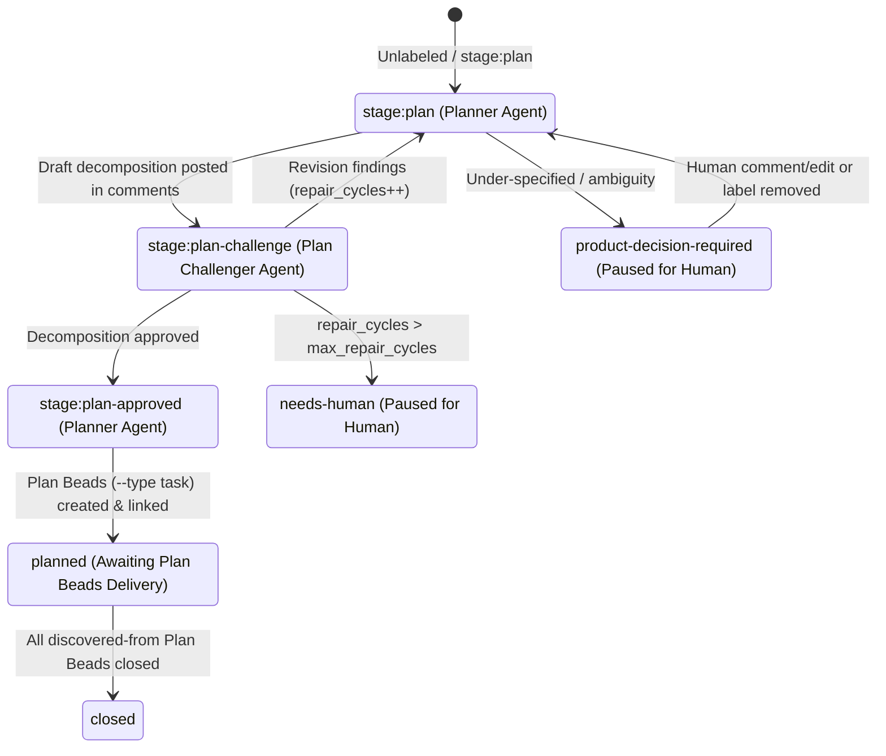
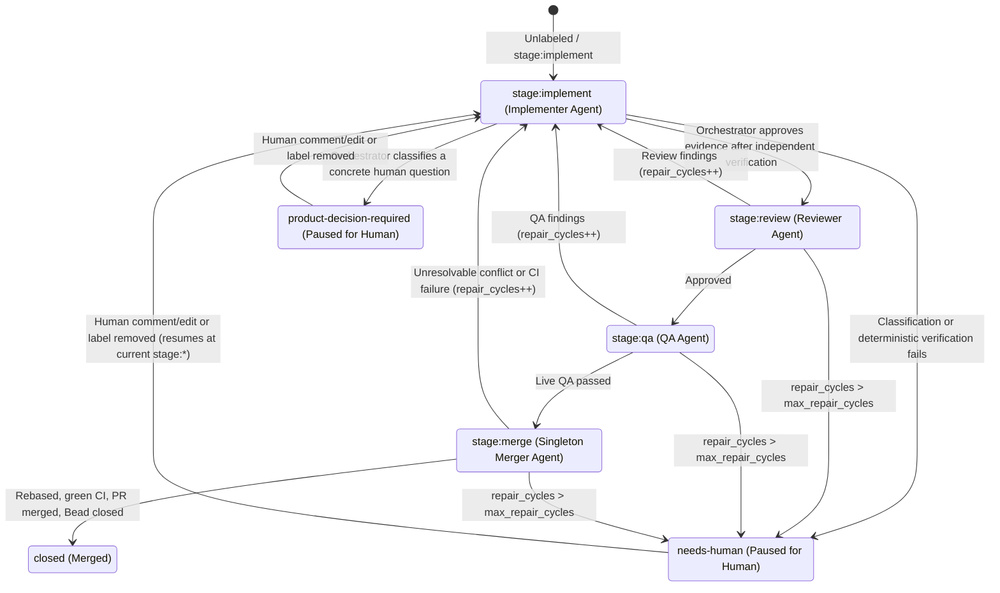
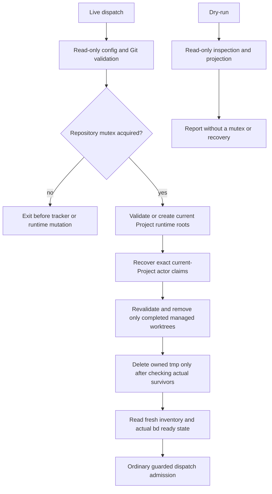

# Nightweaver Architecture Specification

Nightweaver is a standalone, discovery-driven autonomous software factory. Operated against an external **Target Repository** via a named **Project** configuration, the **Orchestrator** monitors a Beads (`bd`) issue tracker, dispatches scoped **Agents** through headless **Agent CLI** processes to plan user-authored **Product Beads** into independently deployable **Plan Beads** (or defer under-specified ones back to humans for clarification), drives those **Plan Beads** through implementation, static review, live QA verification, and serialized merge inside isolated Git worktrees, and deterministically cleans up its execution environment.

Relevant domain vocabulary is defined in [`GLOSSARY.md`](./GLOSSARY.md). Architectural trade-offs are recorded in:
- [ADR 0001: Two-tier Product and Plan Beads](./docs/adr/0001-two-tier-product-and-plan-beads.md)
- [ADR 0002: Beads-native Agent handoff and thin Orchestrator](./docs/adr/0002-beads-native-agent-handoff-and-thin-orchestrator.md)

---

## 1. Architectural Principles & Authority Boundary

1. **Two-Tier Bead Lifecycle (`Product Bead` -> `Plan Bead`)**:
   - **Product Beads** (`--type feature` or `--type bug`) are human-authored Beads describing user-level product requirements or bug reports that enter **Planning**.
   - **Plan Beads** (`--type task`) are Planner-authored (or human-authored) Beads containing a self-contained technical implementation specification ready for **Delivery**, linked to their parent **Product Bead** via `--deps discovered-from:<product-bead-id>`.
   - Every **Plan Bead** slice must be **independently deployable** to `default_branch`. When multiple **Plan Beads** require sequencing, the **Planner Agent** wires native `blocks` dependencies (`bd dep add <later-slice> <earlier-slice>`) between them so `bd ready` enforces ordering automatically.

2. **Beads-Native Workflow State**:
   - All workflow state, stage transitions (`stage:*` labels), human escalation states (`product-decision-required`, `needs-human`), repair cycle counters (`repair_cycles` metadata), and inter-agent findings live directly on the **Product Bead** and **Plan Bead** in `bd`.
   - Nightweaver maintains no separate database or local JSON state store and does not use `bd formula` sub-bead molecules.

3. **Crash-Stateless Orchestrator with Verifiable Agent Evidence**:
   - **Orchestrator responsibilities**:
     - Watch `bd` mutations in the **Target Repository** via `bd events tail --follow`.
     - Claim eligible Beads (`bd update <id> --claim`) and schedule them across three bounded concurrency pools (**Planning**, **Delivery**, and singleton **Merger**).
     - Provision, reset, and clean up isolated Git worktrees, per-invocation temporary directories, and **Win32 Job Objects**.
     - Map each Bead's `(type, stage:* label)` to its corresponding **Agent** role and launch the configured **Agent CLI**.
     - Verify process, worktree, Git, and tracker invariants independently of model answers; classify completed Implementer evidence; publish guarded outcomes; manage operational retries and semantic repair budgets; and auto-close `planned` **Product Beads** once all their `discovered-from` **Plan Beads** reach `closed`.
   - **Agent responsibilities**:
     - Each **Agent** executes directly inside the Bead's isolated worktree with full CLI/tool autonomy within its role mandate (`bd`, `git`, `gh`, and the **Target Repository**'s build/test toolchain).
     - Each **Agent** reads its assigned Bead via `bd show <id>` and `bd comments <id>`, performs its single lifecycle responsibility, and records natural-language findings or evidence via `bd comments add`. The Orchestrator owns verified stage, pause, status, claim, type, and repair-counter transitions.

4. **Zero-Footprint Target Repository Boundary**:
   - Nightweaver stores all **Project** configurations, worktrees, logs, and temporary directories inside the Nightweaver host directory (`<nightweaver-root>/`), leaving zero Nightweaver-specific files inside the **Target Repository**.
   - Repository-specific build, test, QA, architecture, and non-default merge conventions live in the **Target Repository**'s checked-in `AGENTS.md` / `CLAUDE.md`, `GLOSSARY.md`, `docs/adr/`, and repository skills, which the **Agent CLI** loads natively from the worktree.

---

## 2. Bead Lifecycle, States, and Human Handoff Protocol

### 2.1 Planning Lifecycle (`Product Bead`: `--type feature,bug`)



1. **Discovery & Eligibility**:
   - Unblocked, unassigned **Product Beads** (`bd ready --type feature,bug --unassigned`) that do not carry `planned`, `product-decision-required`, or `needs-human` are eligible for **Planning** (subject to `max_active_plan_beads` backpressure; see Section 5.2).
2. **Drafting & Clarification (`stage:plan`)**:
   - The **Planner Agent** evaluates the **Product Bead** (full description and comment history) against the codebase inside a detached-`HEAD` worktree at `origin/<default_branch>`.
   - **Clarification Deferral (`product-decision-required`)**: If product requirements are ambiguous or contradictory, the **Planner Agent** posts a structured clarification comment via `bd comments add <id>` and applies `product-decision-required`.
   - **Candidate Decomposition (`stage:plan-challenge`)**: Once requirements are clear, the **Planner Agent** posts a candidate decomposition of 1:N independently deployable **Plan Beads** (including proposed `blocks` edges and each slice's specification) as a structured comment on the **Product Bead** and transitions its label to `stage:plan-challenge`. No `--type task` **Plan Beads** are created in `bd` yet.
3. **Adversarial Plan Critique (`stage:plan-challenge`)**:
   - The **Plan Challenger Agent** independently critiques the drafted decomposition against the **Product Bead** and codebase (checking slice independence, deployability, missing edge cases, architectural alignment, and dependency ordering):
     - **Revise (`stage:plan`)**: Posts critique findings via `bd comments add`, increments `bd update <id> --set-metadata repair_cycles=<N>`, and transitions the **Product Bead** back to `stage:plan`.
     - **Approve (`stage:plan-approved`)**: Posts approval comment and transitions the **Product Bead** to `stage:plan-approved`.
4. **Plan Materialization (`stage:plan-approved` -> `planned`)**:
   - The **Planner Agent** creates the approved **Plan Beads** in `bd`:
     - `bd create "<title>" -t task --deps discovered-from:<product-bead-id> -d "<spec>"`
     - Each **Plan Bead** description contains a complete, self-contained technical specification: **Summary**, **Current vs. Desired Behavior**, **Key Interfaces & Touchpoints**, **Testable Acceptance Criteria**, and **Out of Scope**.
     - Wires ordering constraints between sibling **Plan Beads** via `bd dep add <later-slice> <earlier-slice>`.
   - Transitions the **Product Bead** label from `stage:plan-approved` to `planned` (leaving the **Product Bead** `open`).
5. **Automatic Product Bead Completion (`planned` -> `closed`)**:
   - Whenever a **Plan Bead** closes, the **Orchestrator** checks whether that **Plan Bead** has a `discovered-from` parent **Product Bead** labelled `planned`. If all **Plan Beads** linked via `discovered-from` to that **Product Bead** are `closed`, the **Orchestrator** automatically closes the parent **Product Bead** (`bd close <product-bead-id>`).

### 2.2 Delivery Lifecycle (`Plan Bead`: `--type task`)



1. **Discovery & Eligibility**:
   - Unblocked, unassigned **Plan Beads** (`bd ready --type task --unassigned`) that do not carry `product-decision-required` or `needs-human` are eligible for **Delivery**.
   - **Plan Beads** without a `stage:*` label or labelled `stage:implement`, `stage:review`, or `stage:qa` are scheduled by the **Delivery Pool**.
   - **Plan Beads** labelled `stage:merge` are scheduled exclusively by the **Singleton Merger Slot**.
2. **Implementation (`stage:implement`)**:
   - The **Implementer Agent** works in the Bead's dedicated worktree on branch `nightweaver/<bead-id>`.
   - Writes or repairs code, automated tests, and domain documentation to satisfy the **Plan Bead** specification and any downstream findings from **Reviewer**, **QA**, or **Merger** recorded in `bd comments`.
   - Runs the local build and test suite, commits changes to `nightweaver/<bead-id>`, pushes the branch (`git push -u origin nightweaver/<bead-id>`), and idempotently opens or updates the GitHub Pull Request (`gh pr create` / `gh pr view`) targeting `<default_branch>` so remote CI starts running immediately in parallel with Review and QA.
   - Posts an implementation summary comment on the **Plan Bead** containing findings, checks, commit/branch/PR evidence, and any human question. It leaves all workflow fields unchanged; the **Orchestrator** classifies the evidence and independently verifies process completion, worktree cleanliness, expected Delivery branch, current HEAD, remote branch, pull request base/head, and absence of unauthorized tracker changes before publishing `stage:review`.
   - A concrete product question is published by the **Orchestrator** as `product-decision-required`. A technical blocker, unclear evidence, unavailable/invalid bounded classification, or failed deterministic verification is escalated as `needs-human`, with the retained work and evidence preserved. Outcome-classification failure never resets work or reruns the completed Implementer.
3. **Static Code & Spec Review (`stage:review`)**:
   - The **Reviewer Agent** evaluates the diff against codebase standards and the **Plan Bead**'s specification without modifying tracked files:
     - **Approve (`stage:qa`)**: Posts an approval comment and transitions the **Plan Bead** to `stage:qa`.
     - **Request Changes (`stage:implement`)**: Posts actionable review findings via `bd comments add`, increments `repair_cycles`, and transitions the **Plan Bead** back to `stage:implement`.
4. **Live QA Verification (`stage:qa`)**:
   - The **QA Agent** boots and exercises the running software against the **Plan Bead**'s acceptance criteria and edge cases to validate live behavior beyond unit tests and static review, then cleans up any temporary test artifacts so the worktree remains clean:
     - **Pass (`stage:merge`)**: Posts QA verification summary and transitions the **Plan Bead** to `stage:merge`.
     - **Fail (`stage:implement`)**: Posts reproduction steps and failure details via `bd comments add`, increments `repair_cycles`, and transitions the **Plan Bead** back to `stage:implement`.
5. **Serialized Rebase, CI Verification, and Merge (`stage:merge`)**:
   - The **Merger Agent** runs in the **Singleton Merger Slot** (concurrency = 1) inside the **Plan Bead**'s worktree:
     1. Fetches `origin/<default_branch>` (`git fetch origin <default_branch>`).
     2. If `nightweaver/<bead-id>` is behind `origin/<default_branch>`, runs `git rebase origin/<default_branch>`.
     3. **Active Conflict Resolution**: If rebase conflicts occur, the **Merger Agent** inspects the conflicting changes, attempts to resolve the conflicts directly, completes the rebase, and runs the local build/test suite to verify the resolution compiles and passes tests.
     4. Pushes the synchronized branch (`git push --force-with-lease`) and waits for remote CI checks on the current `HEAD` (`gh pr checks --watch`) to pass.
     5. Merges the Pull Request (`gh pr merge --squash --delete-branch`, unless overridden by the **Target Repository**'s `AGENTS.md`) and closes the **Plan Bead** (`bd close <id>`).
     6. **Return to Implementer (`stage:implement`)**: If changes on `origin/<default_branch>` semantically invalidate the **Plan Bead**'s design, conflict resolution cannot be completed cleanly, or local tests / remote CI fail after rebase, the **Merger Agent** aborts any in-progress rebase, posts the conflict or CI failure details via `bd comments add`, increments `repair_cycles`, and transitions the **Plan Bead** back to `stage:implement`.

---

## 3. Agent Roster & Authority Matrix

| Role | Stage Input | Permitted Mutations | Legal `bd` Output Transitions |
| :--- | :--- | :--- | :--- |
| **Planner Agent** | **Product Bead**: Unlabeled, `stage:plan`, or `stage:plan-approved` | `bd comments add`, `bd update` labels on **Product Bead**; in `stage:plan-approved`, `bd create -t task` and `bd dep add` for child **Plan Beads**. **No worktree file mutations.** | From `stage:plan`: `stage:plan-challenge` or `product-decision-required`<br>From `stage:plan-approved`: `planned` |
| **Plan Challenger Agent** | **Product Bead**: `stage:plan-challenge` | `bd comments add`, `bd update` label and `repair_cycles` metadata on **Product Bead**. **No worktree file mutations.** | `stage:plan-approved` or `stage:plan` (with `repair_cycles=<N>`) |
| **Implementer Agent** | **Plan Bead**: Unlabeled or `stage:implement` | Edit/commit files on `nightweaver/<bead-id>`, `git push`, `gh pr create`/`edit`, and `bd comments add`. Must leave no new uncommitted changes; inherited contents are preserved. It cannot change status, type, stage/pause labels, assignee, or `repair_cycles`. | No workflow mutation; reports natural-language evidence for Orchestrator classification |
| **Reviewer Agent** | **Plan Bead**: `stage:review` | Read-only review of worktree/diff, `bd comments add`, `bd update` label and `repair_cycles` metadata on **Plan Bead**. **No worktree file or commit mutations.** | `stage:qa`, `stage:implement` (with `repair_cycles=<N>`), or `product-decision-required` |
| **QA Agent** | **Plan Bead**: `stage:qa` | Build/boot/exercise software, `bd comments add`, `bd update` label and `repair_cycles` metadata on **Plan Bead**. Must remove its own test artifacts; inherited dirty contents are preserved and block success if they prevent verification. | `stage:merge`, `stage:implement` (with `repair_cycles=<N>`), or `product-decision-required` |
| **Merger Agent** | **Plan Bead**: `stage:merge` (Singleton) | `git fetch`, `git rebase`, resolve rebase conflicts & run tests, `git push --force-with-lease`, `gh pr checks`, `gh pr merge`, `bd comments add`, `bd update` / `bd close`. **Must leave `git status --porcelain` clean on exit.** | `closed` or `stage:implement` (with `repair_cycles=<N>`) |

---

## 4. Review, Repair Loops, Operational Retries, and Escalation Policy

### 4.1 Cross-Agent Semantic Repair Budgets (`repair_cycles`)

1. **Persistence in `bd` Metadata**:
   - Cross-agent loop counts are persisted on the Bead via `bd update <id> --set-metadata repair_cycles=<N>` whenever work is rejected back to an earlier stage:
     - **Planning**: `stage:plan-challenge` -> `stage:plan` on a **Product Bead**.
     - **Delivery**: `stage:review` -> `stage:implement`, `stage:qa` -> `stage:implement`, or `stage:merge` -> `stage:implement` on a **Plan Bead** (shared budget across Reviewer, QA, and Merger).
2. **Budget Enforcement (`max_repair_cycles`, default `3`)**:
   - In **Planning**, a **Product Bead** allows up to `max_repair_cycles` (default `3`) revision cycles between **Planner Agent** and **Plan Challenger Agent**.
   - In **Delivery**, a **Plan Bead** allows up to `max_repair_cycles` (default `3`) total repair cycles back to `stage:implement`.
   - If a challenge or verification **Agent** returns a Bead to `stage:plan` or `stage:implement` when `repair_cycles` exceeds `max_repair_cycles` (or attempts a 4th cycle), the **Orchestrator** halts the loop and escalates the Bead with `needs-human`.

### 4.2 Within-Stage Operational Retries & Duplicate-Failure Short-Circuit

1. **Operational Failure Definition**:
   - An **Agent CLI** invocation is classified as an **operational failure** when any of the following occur:
     - Process exits with a non-zero exit code.
     - Process exceeds its configured per-role wall-clock timeout (`timeout_minutes`) and is terminated by its **Win32 Job Object**.
     - Worktree fails post-exit cleanliness (`git status --porcelain` is non-empty, or forbidden `HEAD` mutations occurred during a read-only stage).
     - Process exits `0` without performing a legal `bd` state transition out of its pre-dispatch state (per Section 3).
2. **In-Memory Retry Tracking (`max_operational_retries`, default `2`)**:
   - Operational retries are tracked in-memory inside the **Orchestrator** for the active stage without mutating `repair_cycles` metadata in `bd`.
   - Before retrying an initially clean session, the **Orchestrator** may reset the isolated worktree to its recorded `HEAD` and remove untracked, non-ignored files. If a retained session was already dirty when opened, retries preserve its tracked, staged, untracked, ignored, and temporary contents; when those contents prevent a verified success, the **Orchestrator** preserves them and escalates instead of resetting them.
3. **Duplicate-Failure Short-Circuit (`classifier` role)**:
   - Up to `max_operational_retries` (default `2` retries = `3` total attempts within a stage), when a retry also fails operationally, the **Orchestrator** invokes a lightweight headless **Agent CLI** call (`classifier` role config) comparing the latest failed invocation's error/log tail against the previous failed invocation's error/log tail.
   - If the classifier determines both failures share the **same underlying error**, the **Orchestrator** short-circuits remaining retries and immediately escalates the Bead with `needs-human`.
   - If all `1 + max_operational_retries` attempts fail, the **Orchestrator** escalates the Bead with `needs-human`.
4. **Implementer Outcome Classification**:
   - For each completed Implementer invocation, the **Orchestrator** assembles bounded evidence from that invocation's retained log and fresh Bead comments, with source IDs and truncation indicators. Evidence is untrusted data and cannot authorize instructions or state changes.
   - The primary classifier sends one named choice question to OpenAI `POST /v1/decisions` using `gpt-6-luna` and ambient `OPENAI_API_KEY`. If credentials, network, response, or strict answer validation are unavailable, the **Orchestrator** makes at most one fallback attempt through the configured standard Agent CLI `classifier` role, using the identical question, choices, and evidence. The classifier has no workflow mutation authority. Cancellation does not start a fallback.
   - The allowed outcomes are `ready_for_review`, `product_decision_required`, `technical_blocker`, and `incomplete_or_unclear`. A valid unclear or other non-approval result is not sent for a more decisive second opinion. Malformed, ambiguous, missing, oversized, timed-out, or non-zero fallback output escalates directly.
   - Model approval is not sufficient: successful process exit, unchanged tracker ownership/workflow state, clean worktree, exact `nightweaver/<bead-id>` branch, valid HEAD, matching `origin` branch, and an open pull request with the configured base and matching head commit must be verified independently before `stage:review` is published.
   - Classification or outcome-verification failure preserves the completed work, invocation log, and evidence; stage and repair count remain unchanged before `needs-human` escalation. It is a finalization outcome, not an operational work retry, and the Implementer is not rerun.

### 4.3 Human Escalation (`product-decision-required` and `needs-human`) & Auto-Resumption

1. **Escalation Labels**:
   - `product-decision-required`: Applied by the **Orchestrator** after classifying a concrete product ambiguity, contradiction, trade-off, or reported human question. Agents report the question in evidence and never apply the pause label.
   - `needs-human`: Applied by the **Orchestrator** when a Bead exhausts `max_repair_cycles`, exhausts `max_operational_retries` (or triggers the duplicate-failure short-circuit), fails bounded outcome classification or deterministic outcome verification, or hits an unresolvable environment/technical blocker. The **Orchestrator** posts a structured diagnostic comment containing the failure reason, latest findings, and the log file path under `<nightweaver-root>/logs/<project-slug>/<bead-id>/`.
2. **Worktree, Branch, and PR Disposition on Pause**:
   - When a Product Bead or Plan Bead pauses with `product-decision-required` or `needs-human`, the Orchestrator retains its local worktree, current HEAD, staged and unstaged changes, untracked and ignored files, branch refs, Pull Request, logs, and all Bead temporary files. It records a diagnostic and releases only its still-owned claim. Pause labels override planned or closed cleanup candidates; closed Beads are never reopened to record a pause.
   - Its parent `planned` **Product Bead** remains `planned`, unrelated sibling **Plan Beads** continue executing normally, and `blocks`-dependent sibling **Plan Beads** remain naturally blocked by `bd ready`.
3. **Automatic Resumption**:
   - The **Orchestrator** skips any Bead carrying `product-decision-required` or `needs-human` until it detects either:
     - New human comment or description update activity timestamped after the escalation comment/event, or
     - Manual removal of the `product-decision-required` / `needs-human` label.
   - Upon detection, the Orchestrator removes the escalation label (if present), resets the repair budget, and schedules the Bead at its current stage. A validated retained worktree resumes at its current HEAD; fetching or incorporating remote changes requires an explicit operation.

---

## 5. Orchestrator Concurrency, Event-Driven Discovery, and Worktree Isolation

### 5.1 Event-Driven Discovery via `bd events tail --follow`

**Repository Exclusion and Startup Recovery for Live Dispatch**:
Before any Beads inventory/readiness query, recovery, dispatch write, Project runtime-directory creation, worktree operation, or Agent launch, a live Orchestrator performs read-only configuration and Git validation, then acquires an OS-managed mutex keyed to the physical Git common-directory identity. The mutex is shared by every Project name and Nightweaver host root that targets the same local repository, is outside the Target Repository, and remains owned for the process lifetime. A competing process exits with a diagnostic before tracker or runtime mutations. Process exit or death releases ownership; no lease database, heartbeat, or PID proof is used.

While holding the mutex, the Orchestrator validates the current Project's worktree, temporary, and log roots and every ancestor. Safe missing directories may be created under the mutex. An inaccessible parent, file in place of a directory, reparse-point shared root, or otherwise unusable root fails startup. Read-only inspection and `--dry-run` do not acquire recovery authority.

The Orchestrator reads the complete Beads inventory and considers only `in_progress` claims whose assignee exactly matches the current Project's recovery actor. Before each release it rereads that Bead and applies one guarded update requiring the observed `in_progress` status and exact assignee, changing only status to `open` and assignee to empty. Stages, pause labels, repair counts, comments, dependencies, and other Bead fields remain intact. Unassigned, lookalike, foreign-person, and other-Project claims are untouched.

A guard mismatch triggers fresh inspection and the observed state is respected. An update with an uncertain result is reread and never blindly replayed. Required inventory/recovery read or write failures stop startup. Once recovery finishes, the Orchestrator obtains a fresh inventory and actual native `bd ready` snapshot; admission uses that state, never projected recovery success. Paused or blocked claims remain ineligible.

Before that fresh admission snapshot, live startup performs a separate conservative completed-environment sweep. It removes only a safely identified `planned` Product Bead's detached Planning worktree or a closed Plan Bead's exact `nightweaver/<bead-id>` Delivery worktree, after rereading current Bead state and validating the canonical Project path, registration, ownership, checkout identity, lock state, and path safety. A pause or changed identity cancels the stale removal. Locked, missing/prunable, unregistered, deleted-Bead, linked, or ambiguous leftovers remain in place and are diagnosed. Startup never runs repository-wide worktree pruning or deletes branches by name. It checks actual surviving registrations and directories before deleting a known completed Bead's tmp tree. A local removal failure records its path and reason, adds `needs-human` without reopening a closed Bead, protects remaining resources, and allows unrelated recovery to continue; failure to persist required escalation state or an unusable shared root stops startup.


1. **Durable Events Journal Initialization**:
   - Nightweaver does not use fixed-interval polling. On startup for a **Project**, the **Orchestrator** ensures `bd`'s built-in durable events journal is enabled on the **Target Repository** (`bd config set events-journal true` / `BD_EVENTS_JOURNAL=1`), captures the current head sequence number, performs the startup crash sweep (Section 5.4), and runs an initial discovery pass (`bd ready` and paused-Bead activity check).
2. **Reactive Scheduling Loop**:
   - The **Orchestrator** maintains a persistent `bd events tail --follow --since <head>` child stream against the **Target Repository**.
   - Every committed tracker mutation (`create`, `update`, `close`, `delete`, `dep_add`, `dep_remove`, `comment`)—as well as every internal pool slot completion—triggers a scheduling evaluation across:
     - Paused Beads (`product-decision-required` / `needs-human`) for new human activity resumption.
     - Active **Plan Bead** count for **Planning** backpressure.
     - Unblocked **Product Beads** for the **Planning Pool**.
     - Unblocked **Plan Beads** (`stage:implement`, `stage:review`, `stage:qa`, or unlabeled) for the **Delivery Pool**.
     - Unblocked `stage:merge` **Plan Beads** for the **Singleton Merger Slot**.
   - If the `bd events tail --follow` stream exits unexpectedly or emits `events_journal_truncated`, the **Orchestrator** automatically re-baselines with a full query pass and restarts the tail stream.

### 5.2 Three Concurrency Pools & Planning Backpressure

1. **Planning Pool (`max_concurrent_planning`, default `2`)**:
   - Claims eligible Product Beads and holds the claim across the Planning stages. On planned, completed-environment cleanup may remove the detached worktree; on either pause label, the worktree and temporary files are retained and the still-owned claim is released.
2. **Planning Backpressure (`max_active_plan_beads`, default `5`)**:
   - To prevent **Planning** from building a large queue of pre-planned **Plan Beads** that go stale as `<default_branch>` evolves, the **Orchestrator** counts all active (non-closed, non-paused) **Plan Beads** (`--type task` with status `open` or `in_progress` that do not carry `product-decision-required` or `needs-human`).
   - When `active_plan_beads >= max_active_plan_beads`, the **Orchestrator** pauses claiming *new* **Product Beads** for **Planning** until `active_plan_beads < max_active_plan_beads`. Any **Product Bead** already mid-Planning in an active slot finishes its current Planning loop cleanly.
3. **Delivery Pool (`max_concurrent_delivery`, default `3`)**:
   - Claims eligible **Plan Beads** (`bd update <id> --claim`) that are unlabeled or in `stage:implement`, `stage:review`, or `stage:qa`.
   - A Delivery slot holds the claim and persistent worktree continuously across Orchestrator-verified `stage:implement` -> `stage:review` -> `stage:qa` outcomes (including immediate `-> stage:implement` repair cycles) until the **Plan Bead** reaches `stage:merge` or pauses (`product-decision-required` / `needs-human`), at which point it releases the `bd` claim (`--status open --assignee ""`) and frees the Delivery slot immediately without deleting the worktree (when transitioning to `stage:merge`).
4. **Singleton Merger Slot (concurrency = `1`)**:
   - Dedicated to `stage:merge` **Plan Beads** (`bd ready --type task --label stage:merge --unassigned`).
   - Claims and processes one `stage:merge` **Plan Bead** at a time in priority/FIFO order so rebase, conflict resolution, and remote CI waits never block **Delivery Pool** slots.
   - If a `stage:merge` **Plan Bead** is returned to `stage:implement` (conflict/CI failure), the **Merger** releases the claim so the **Delivery Pool** picks it back up on `nightweaver/<bead-id>`.

### 5.3 Worktree & Runtime Environment Isolation

1. **Host Directory Layout**:
   ```text
   <nightweaver-root>/
   ├── projects/
   │   └── <project-slug>.json
   ├── prompts/
   │   ├── planner.md
   │   ├── plan-challenger.md
   │   ├── implementer.md
   │   ├── reviewer.md
   │   ├── qa.md
   │   └── merger.md
   ├── worktrees/
   │   └── <project-slug>/
   │       └── <bead-id>/
   ├── logs/
   │   └── <project-slug>/
   │       └── <bead-id>/
   │           └── <timestamp>-<role>.log
   └── tmp/
       └── <project-slug>/
           └── <bead-id>/
               └── <timestamp>-<role>/
   ```
2. **Target Repository Root Invariant**:
   - The **Orchestrator** never checks out branches, mutates files, or executes **Agents** in the **Target Repository** root checkout. The root checkout is used solely for `git fetch origin`, `git worktree` management, and `bd` queries.
   - Because `bd` natively discovers the shared `.beads` database via the Git common directory, **Agents** execute standard `bd` commands directly inside their worktrees with zero path redirection.
    - **Cross-Project Process Exclusion**: the mutex key comes from the local physical Git common directory, not a Project slug or host path. It is acquired before Beads inventory, applies across copied Nightweaver hosts, and remains held when recovery or dispatch fails. No persistent lock file or tracker-side lease is created.
3. **Planning Worktrees (Detached `HEAD`)**:
   - Fresh worktrees are created at `<nightweaver-root>/worktrees/<project-slug>/<bead-id>` via:
     `git fetch origin <default_branch> && git worktree add --detach <path> origin/<default_branch>`
   - A validated retained Planning worktree resumes at its current detached HEAD without fetch, reset, or clean. Fresh worktrees are verified clean after creation. Existing dirty contents are preserved; if a run cannot meet current success checks with inherited changes, they remain available for diagnosis and escalation.
4. **Delivery Worktrees (Persistent Branch `nightweaver/<bead-id>`)**:
   - Created at `<nightweaver-root>/worktrees/<project-slug>/<bead-id>` on branch `nightweaver/<bead-id>`:
     - If `origin/nightweaver/<bead-id>` exists on remote (resuming after pause or restart), created tracking `origin/nightweaver/<bead-id>`.
     - Otherwise created from `origin/<default_branch>` (`git worktree add -B nightweaver/<bead-id> <path> origin/<default_branch>`).
   - Persists on disk across `stage:implement` -> `stage:review` -> `stage:qa` -> `stage:merge` and across repair loops so build artifacts and package caches stay warm.
   - A validated retained Delivery worktree is reused on its exact branch without fetch, checkout, reset, or clean. Fresh worktrees are verified clean after creation. A retry may reset an initially clean session to its recorded HEAD; it preserves all contents inherited from a dirty session.
5. **Environment Isolation**:
   - Every spawned **Agent CLI** receives:
     - `NIGHTWEAVER_BEAD_ID=<bead-id>`
     - Invocation-scoped `TMP`, `TEMP`, and `TMPDIR` pointing to `<nightweaver-root>/tmp/<project-slug>/<bead-id>/<timestamp>-<role>/`
   - Nightweaver does not inject slot port variables (`NIGHTWEAVER_SLOT_ID`); **Target Repositories** use ephemeral runtime environments (such as .NET Aspire) that avoid port collisions natively.
6. **Startup Cleanup Ownership**:
   - Only the **Orchestrator** removes completed managed environments during startup. It matches Product/Plan role, current completion state, canonical Bead-ID child path, and the checkout's actual Target Repository identity before targeted removal. Agents and branch names do not establish cleanup ownership.
   - Startup retains every paused, unfinished, locked, missing/prunable, unregistered, unsafe-link, deleted-Bead, or ambiguous environment and its associated tmp. It does not use broad `git worktree prune` or delete local/remote branches. Ordinary Delivery completion branch cleanup remains a separate lifecycle responsibility.

### 5.4 Deterministic Cleanup Contract

| Lifecycle Event | Cleanup Actions |
| :--- | :--- |
| **Every Agent CLI Exit** | Close the **Win32 Job Object** (terminating the **Agent CLI** and any child processes, test servers, or browsers). Retain `<nightweaver-root>/logs/<project-slug>/<bead-id>/<timestamp>-<role>.log`. |
| **Planning Completion (`planned`)** | Remove the detached worktree, prune its completed registration, delete the Bead temporary tree, and release the claim. |
| **Planning or Delivery Pause (`product-decision-required` / `needs-human`)** | Retain the worktree, current HEAD, branch refs, tracked and untracked files, ignored caches, logs, and all Bead temporary files; record the diagnostic and release only the still-owned claim. |
| **Delivery Completion (`closed`)** | Remove the local worktree (`git worktree remove --force <path>`), delete the local branch (`git branch -D nightweaver/<bead-id>`), ensure remote branch `origin/nightweaver/<bead-id>` is deleted, run `git worktree prune`, delete `<nightweaver-root>/tmp/<project-slug>/<bead-id>/`, and auto-close the parent `planned` **Product Bead** if all its `discovered-from` **Plan Beads** are now `closed`. |
| **Orchestrator Startup (Crash Recovery)** | Under repository-wide process exclusion, release only exact current-Project actor-matching `in_progress` claims with status/assignee guards and fresh rereads; do not reclaim claims or reset stage, pause, or repair state. Required tracker failures and unusable shared runtime roots stop startup. |
| **Orchestrator Startup (Completed-Environment Sweep)** | After claim recovery and before admission, remove only revalidated `planned` Product Bead detached worktrees and closed Plan Bead worktrees on their exact `nightweaver/<bead-id>` branches. Retain and diagnose locked, missing/prunable, unregistered, unsafe-link, deleted-Bead, paused, or ambiguous environments. Use targeted worktree removal only; keep branch refs and logs. Delete known completed-Bead tmp only after observing actual surviving environments. A local failure preserves remaining resources, records path/reason, pauses the existing Bead without reopening closed status, and continues unrelated cleanup. Required escalation persistence or shared-root failure stops startup. |

---

## 6. Agent CLI Contract & Role Prompt Packaging

1. **Supported Agent CLIs**:
   - Nightweaver supports **Claude Code** (`claude`) and **Codex CLI** (`codex`) behind a unified headless launch abstraction:
     - **Claude Code**: `claude -p --dangerously-skip-permissions --no-session-persistence [--model <model>] --effort <effort>` (prompt piped via `stdin`).
     - **Codex CLI**: `codex exec --dangerously-bypass-approvals-and-sandbox --ephemeral [--model <model>] -c model_reasoning_effort="<effort>" -` (prompt piped via `stdin`).
   - If `model` is omitted or `null` for a role, the **Orchestrator** omits `--model` so the **Agent CLI** uses its ambient configured default model.
2. **Win32 Job Object Containment**:
   - Every spawned **Agent CLI** process is assigned to a dedicated **Win32 Job Object** configured with `JOB_OBJECT_LIMIT_KILL_ON_JOB_CLOSE` and a per-role wall-clock timeout (`timeout_minutes`). Closing the Job Object handle on exit, timeout, force shutdown, or **Orchestrator** crash guarantees termination of the entire child process tree.
3. **Plain-File Role Prompts & Dispatch Payload**:
   - Nightweaver ships 6 editable Markdown prompt templates under `prompts/` (`planner.md`, `plan-challenger.md`, `implementer.md`, `reviewer.md`, `qa.md`, `merger.md`), copied to the build output so prompts can be inspected and tuned without recompiling C#.
   - At dispatch time, the **Orchestrator** prepends a compact dispatch header (Bead ID, Bead type, current `stage:*` label, `default_branch`, and remaining repair budget) to the role's Markdown template and pipes the combined payload to the **Agent CLI** via `stdin`.
4. **Ambient Host Authentication**:
   - The **Orchestrator** passes the host user's ambient environment variables through untouched (never stripping, overriding, or managing API keys or auth tokens) so `claude`, `codex`, `git`, `gh`, and `bd` use the operator's native credentials.

---

## 7. Project Configuration & CLI Entrypoints

### 7.1 Project Configuration Schema (`<nightweaver-root>/projects/<project-slug>.json`)

Each **Project** configuration binds one **Target Repository** to the **Orchestrator** settings used to run Nightweaver against it.

- **Built-in defaults**:
  - `target_repository.default_branch`: `"main"`
  - `concurrency`: `max_concurrent_planning = 2`, `max_concurrent_delivery = 3`, `max_active_plan_beads = 5` (plus singleton Merger slot = `1`)
  - `limits`: `max_repair_cycles = 3`, `max_operational_retries = 2`
  - `agent_defaults`: `{ "cli": "claude", "model": null, "effort": "high", "timeout_minutes": 30 }` (`model` is optional; when omitted or `null`, the **Agent CLI** uses its own default model)
  - `roles`: optional per-role overrides for `planner`, `plan_challenger`, `implementer`, `reviewer`, `qa`, `merger`, and `classifier`. Any role or field omitted from `roles` inherits from `agent_defaults`.

**Illustrative example** (showing optional per-role overrides and cross-model adversarial routing):

```json
{
  "name": "my-app",
  "target_repository": {
    "path": "H:/code/my-app",
    "default_branch": "main"
  },
  "concurrency": {
    "max_concurrent_planning": 2,
    "max_concurrent_delivery": 3,
    "max_active_plan_beads": 5
  },
  "limits": {
    "max_repair_cycles": 3,
    "max_operational_retries": 2
  },
  "agent_defaults": {
    "cli": "claude",
    "effort": "high",
    "timeout_minutes": 30
  },
  "roles": {
    "planner": {
      "cli": "claude",
      "model": "<model-id>",
      "effort": "high",
      "timeout_minutes": 30
    },
    "plan_challenger": {
      "cli": "codex",
      "model": "<model-id>",
      "effort": "high",
      "timeout_minutes": 20
    },
    "implementer": {
      "cli": "claude",
      "model": "<model-id>",
      "effort": "high",
      "timeout_minutes": 45
    },
    "reviewer": {
      "cli": "codex",
      "model": "<model-id>",
      "effort": "high",
      "timeout_minutes": 20
    },
    "qa": {
      "cli": "claude",
      "model": "<model-id>",
      "effort": "high",
      "timeout_minutes": 30
    },
    "merger": {
      "cli": "claude",
      "model": "<model-id>",
      "effort": "medium",
      "timeout_minutes": 20
    },
    "classifier": {
      "cli": "claude",
      "model": "<model-id>",
      "effort": "low",
      "timeout_minutes": 2
    }
  }
}
```

### 7.2 CLI Entrypoints & Shutdown Modes

1. **CLI Invocation**:
   - `nightweaver --project <project-slug>` (loads `<nightweaver-root>/projects/<project-slug>.json`)
   - `nightweaver --config <path-to-project-json>`
   - `--dry-run`: Runs startup recovery inspection and initial discovery against the **Target Repository** and prints the actions that *would* be taken across the **Planning**, **Delivery**, and **Merger** pools without acquiring recovery authority, mutating `bd`, creating/removing worktrees, or launching **Agents**, then exits.
2. **Two-Mode Shutdown**:
   - **Graceful Shutdown (Default — first `Ctrl+C` / `SIGINT` / stop signal)**:
     - Immediately stops claiming new Beads and stops advancing active Beads to subsequent stages in their pool loop.
     - Waits for currently running **Agent CLI** processes to finish their invocation and post-exit `bd` verification.
     - Releases all active `in_progress` `bd` claims (`bd update <id> --status open --assignee ""`), cleans up any completed/paused worktrees per Section 5.4, and exits cleanly.
   - **Immediate Force Shutdown (Second `Ctrl+C` / force-stop signal)**:
     - Immediately closes all active **Win32 Job Objects** (terminating all running **Agent CLI** processes and child process trees).
     - Resets any mid-invocation worktrees (`git reset --hard HEAD && git clean -fd`).
     - Releases all active `in_progress` `bd` claims (`bd update <id> --status open --assignee ""`) and exits immediately.

---

## 8. Out of Scope

- **Multi-Project Management UI**: A project-agnostic UI for creating/editing **Project** configurations, viewing/interacting with each **Project**'s `bd` tracker, and starting/monitoring/stopping per-**Project** **Orchestrator** processes is deferred to a separate effort.
- **Internal C# Module & Interface Layout**: File-level C# class/interface decompositions and method signatures are deferred to implementation planning.
- **Final Prose of Role Prompts**: The exact prose wording of `prompts/*.md` will be authored during implementation of the role prompt templates.
