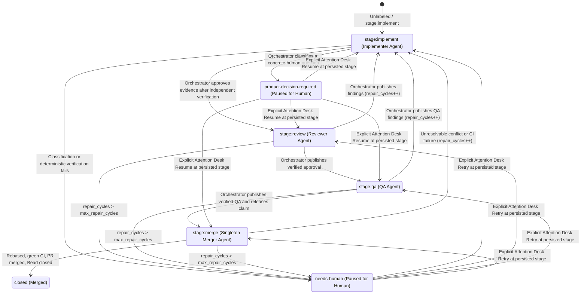
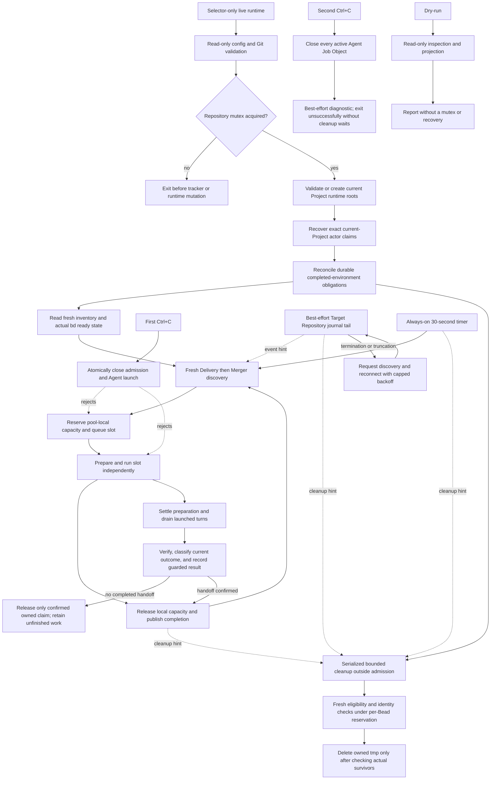

# Nightweaver Architecture Specification

Nightweaver is a standalone, discovery-driven autonomous software factory. Operated against an external **Target Repository** via a named **Project** configuration, the **Orchestrator** monitors a Beads (`bd`) issue tracker, dispatches scoped **Agents** through headless **Agent CLI** processes to plan user-authored **Product Beads** into independently deployable **Plan Beads** (or defer under-specified ones back to humans for clarification), drives those **Plan Beads** through implementation, static review, live QA verification, and serialized merge inside isolated Git worktrees, and deterministically cleans up its execution environment.

Relevant domain vocabulary is defined in [`GLOSSARY.md`](./GLOSSARY.md). Architectural trade-offs are recorded in:
- [ADR 0001: Two-tier Product and Plan Beads](./docs/adr/0001-two-tier-product-and-plan-beads.md)
- [ADR 0002: Beads-native Agent handoff and thin Orchestrator](./docs/adr/0002-beads-native-agent-handoff-and-thin-orchestrator.md)

---

## 1. Architectural Principles & Authority Boundary

1. **Two-Tier Bead Lifecycle (`Product Bead` -> `Plan Bead`)**:
   - **Product Beads** (`--type feature` or `--type bug`) are human-authored Beads describing user-level product requirements or bug reports that enter **Planning**.
   - **Plan Beads** (`--type task`) are maintainer-authored Beads containing a self-contained technical implementation specification ready for **Delivery**, optionally linked to their parent **Product Bead** via `--deps discovered-from:<product-bead-id>`. Automated Planning is outside the current runtime.
   - Every **Plan Bead** slice must be **independently deployable** to `default_branch`. When multiple **Plan Beads** require sequencing, the **Planner Agent** wires native `blocks` dependencies (`bd dep add <later-slice> <earlier-slice>`) between them so `bd ready` enforces ordering automatically.

2. **Beads-Native Workflow State**:
   - All workflow state, stage transitions (`stage:*` labels), human escalation states (`product-decision-required`, `needs-human`), repair cycle counters (`repair_cycles` metadata), and inter-agent findings live directly on the **Product Bead** and **Plan Bead** in `bd`.
   - Nightweaver maintains no separate workflow database or local workflow state store and does not use `bd formula` sub-bead molecules. Durable completed-environment cleanup obligations are operational evidence, separate from Bead lifecycle state and runtime telemetry.

3. **Crash-Stateless Orchestrator with Verifiable Agent Evidence**:
   - **Orchestrator responsibilities**:
     - Use a best-effort `bd events tail --follow` on the configured **Target Repository** as a discovery wake-up hint; periodic discovery remains active when the journal is unavailable.
     - Claim eligible manually authored tasks (`bd update <id> --claim`) and schedule them through the active bounded pools in order: **Delivery**, then singleton **Merger**. Planning remains manually authored and can compose later.
     - Provision, reset, and clean up isolated Git worktrees, per-invocation temporary directories, and **Win32 Job Objects**.
     - Map each Bead's `(type, stage:* label)` to its corresponding **Agent** role and launch the configured **Agent CLI**.
     - Verify process, worktree, Git, and tracker invariants independently of model answers; classify Delivery and Merger evidence; publish guarded outcomes; manage operational retries and semantic repair budgets; and auto-close eligible `planned` **Product Beads** after their discovered tasks close.
   - **Agent responsibilities**:
     - Each **Agent** executes directly inside the Bead's isolated worktree with full CLI/tool autonomy within its role mandate (`bd`, `git`, `gh`, and the **Target Repository**'s build/test toolchain).
     - Each **Agent** reads its assigned Bead via `bd show <id>` and `bd comments <id>`, performs its single lifecycle responsibility, and records natural-language findings or evidence via `bd comments add`. The Orchestrator owns verified stage, pause, status, claim, type, and repair-counter transitions.

4. **Zero-Footprint Target Repository Boundary**:
   - Nightweaver stores all **Project** configurations, worktrees, logs, and temporary directories inside the Nightweaver host directory (`<nightweaver-root>/`), leaving zero Nightweaver-specific files inside the **Target Repository**.
   - Repository-specific build, test, QA, architecture, and non-default merge conventions live in the **Target Repository**'s checked-in `AGENTS.md` / `CLAUDE.md`, `GLOSSARY.md`, `docs/adr/`, and repository skills, which the **Agent CLI** loads natively from the worktree.

---

## 2. Bead Lifecycle, States, and Human Handoff Protocol

### 2.1 Planning Lifecycle (`Product Bead`: `--type feature,bug`)

```mermaid
stateDiagram-v2
    [*] --> StagePlan: Unlabeled / stage:plan
    StagePlan: stage:plan (Planner Agent)
    StagePlanChallenge: stage:plan-challenge (Plan Challenger Agent)
    StagePlanApproved: stage:plan-approved (Planner Agent)
    ProductDecision: product-decision-required (Paused for Human)
    NeedsHuman: needs-human (Paused for Human)
    Planned: planned (Awaiting Plan Beads Delivery)
    Closed: closed

    StagePlan --> ProductDecision: Under-specified / ambiguity
    ProductDecision --> StagePlan: Explicit Attention Desk Resume (guarded; stage preserved)
    StagePlan --> StagePlanChallenge: Draft decomposition posted in comments
    StagePlanChallenge --> StagePlan: Revision findings (repair_cycles++)
    StagePlanChallenge --> NeedsHuman: repair_cycles > max_repair_cycles
    StagePlanChallenge --> StagePlanApproved: Decomposition approved
    StagePlanApproved --> Planned: Plan Beads (--type task) created & linked
    Planned --> Closed: All discovered-from Plan Beads closed
```



1. **Discovery & Eligibility**:
   - Unblocked, unassigned **Product Beads** (`bd ready --type feature,bug --unassigned`) that carry `ready-for-planning` and do not carry `planned`, `product-decision-required`, or `needs-human` are eligible for **Planning** (subject to `max_active_plan_beads` backpressure; see Section 5.2).
   - Product intake and prose edits leave the Product in backlog. The workspace's explicit **Ready for Planning** action adds `ready-for-planning` after comparing the displayed workflow identity with fresh state. It accepts only open, unassigned, unpaused Products with a valid Planning stage (or no stage), using a native open/unassigned guarded update and a confirming read. Readiness persists through Planning and human pauses; Resume/Retry still govern the pause independently. Neither action starts an Agent or bypasses native readiness and capacity. Explicit stage dispatch requires the same readiness label.
2. **Grounded execution (`stage:plan` and `stage:plan-challenge`)**:
   - Explicit opted-in Product dispatch runs one reusable Planning turn through the existing operational retry, role-specific bounded classification and deterministic verification pipeline. Continuous Planning pool registration remains separate.
   - Planner and Challenger leave workflow state and claims unchanged. The Orchestrator alone publishes stages, approval, pause, repair accounting and claim release under fresh owner/status guards. Comments are evidence, never transition or Resume authority.
   - Planner records a recoverable candidate with executable tasks, observable acceptance criteria, advisory implementation approaches, separately sourced hard constraints, dependencies, verification and complete Product requirement coverage. Existing code alone creates no binding requirement. Every Product requirement maps to work, satisfaction evidence or a Product-authorized exclusion.
   - Challenger assesses the exact candidate comment ID and content hash, checking boundedness, dependencies, verification, collective coverage and design assumptions leaking into acceptance criteria. Findings identify outcome/contract violations with evidence and direction. Disproven assumptions revise affected plans rather than repeating them unchanged.
   - The host captures Product text and ordinary discussion, retained checkout revision and local default-branch revision before the turn, checks them after classification and again before publication. Changed grounding requires targeted Challenger revalidation of affected portions while preserving unaffected work. This is local evidence freshness, not remote fetch or retained-worktree refresh (tracked separately).
   - Planner `ready_for_review` publishes `stage:plan-challenge`; Challenger `approved` publishes `stage:plan-approved`; verified `changes_required` publishes `stage:plan` and increments the existing repair counter within its configured budget. Exhaustion, invalid classification, failed verification or a blocker preserves evidence and pauses through the existing needs-human path without rerunning a completed classified turn. Operational failures retain their configured retry budget.
   - Material product uncertainty requires concrete questions, recommended answers and tradeoffs. The Orchestrator publishes `product-decision-required` and releases the claim; guarded Attention Desk Resume/Retry governs further eligibility. Pauses and interruptions retain worktrees, tmp and comments.
3. **Approved identity (`stage:plan-approved`)**:
   - Approval binds the exact recoverable candidate comment ID/hash, supporting review comment ID/hash and grounding in a host outcome comment. Later candidate edits or relevant input changes require renewed review. Consumers must recheck this identity; the stage label alone is insufficient.
   - Evidence formats and recovery checks are documented in [Planning evidence](docs/agents/planning-evidence.md).
4. **Task materialization and publication**:
   - Claimed `stage:plan-approved` dispatch uses deterministic Orchestrator publication without another Agent turn or human plan approval. The claimed Planning coordinator can continue directly from Challenger approval into publication. Exact candidate/review identity and current grounding are rechecked before writes; a stage label or a child count alone cannot establish completeness.
   - Every generated task must carry `plan-unpublished` in its initial create write. Keep the hold through partial creation, linking, verification failures and recovery. Only verified publication of the entire approved task set may release holds. Comments or a parent's `planned` label alone never authorize Delivery.
   - Task IDs derive from the Product, approved candidate hash and plan entry. Initial creation includes provenance and the native `discovered-from` link. The host verifies all task content, sourced constraints, acceptance criteria and exact dependency edges before recording release evidence. It reconciles actual tracker state after uncertain writes instead of repeating a create. Conflicting or unmapped work, foreign ownership, changed approval and incomplete verification preserve evidence and use the existing guarded human pause.
   - Release evidence permits recovery across partial hold removal, but no generated task enters Delivery until a final guarded Product update publishes `planned` and its immutable graph snapshot together. Native readiness is additionally gated against the complete snapshot, including content and dependencies. The same gate applies to explicit stage dispatch. Manual tasks retain their existing admission behavior.
   - Startup may recover the exact owned approved-stage claim for reconciliation while retaining unfinished worktrees and tmp. Human-paused Products still require explicit Attention Desk Resume/Retry; comments and release evidence never clear a pause. Changed executing graphs stop further admission and require human-guided replanning; the host never overwrites completed or in-flight task content or dependencies.
5. **Automatic Product Bead Completion (`planned` -> `closed`)**:
   - Whenever a **Plan Bead** closes, the **Orchestrator** checks whether that **Plan Bead** has a `discovered-from` parent **Product Bead** labelled `planned`. If all **Plan Beads** linked via `discovered-from` to that **Product Bead** are `closed`, the **Orchestrator** automatically closes the parent **Product Bead** (`bd close <product-bead-id>`).

### 2.2 Delivery Lifecycle (`Plan Bead`: `--type task`)



1. **Discovery & Eligibility**:
   - Unblocked, unassigned **Plan Beads** (`bd ready --type task --unassigned`) that do not carry `plan-unpublished`, `product-decision-required`, or `needs-human` are eligible for **Delivery**.
   - **Plan Beads** without a `stage:*` label or labelled `stage:implement`, `stage:review`, or `stage:qa` are scheduled by the **Delivery Pool**.
   - **Plan Beads** labelled `stage:merge` are scheduled exclusively by the **Singleton Merger Slot**.
2. **Implementation (`stage:implement`)**:
   - The **Implementer Agent** works in the Bead's dedicated worktree on branch `nightweaver/<bead-id>`.
   - Writes or repairs code, automated tests, and domain documentation to satisfy the **Plan Bead** specification and any downstream findings from **Reviewer**, **QA**, or **Merger** recorded in `bd comments`.
   - Runs the local build and test suite, commits changes to `nightweaver/<bead-id>`, pushes the branch (`git push -u origin nightweaver/<bead-id>`), and idempotently opens or updates the GitHub Pull Request (`gh pr create` / `gh pr view`) targeting `<default_branch>` so remote CI starts running immediately in parallel with Review and QA.
   - Posts an implementation summary comment on the **Plan Bead** containing findings, checks, commit/branch/PR evidence, and any human question. It leaves all workflow fields unchanged; the **Orchestrator** classifies the evidence and independently verifies process completion, worktree cleanliness, expected Delivery branch, current HEAD, remote branch, pull request base/head, and absence of unauthorized tracker changes before publishing `stage:review`.
   - A concrete product question is published by the **Orchestrator** as `product-decision-required`. A technical blocker, unclear evidence, unavailable/invalid bounded classification, or failed deterministic verification is escalated as `needs-human`, with the retained work and evidence preserved. Outcome-classification failure never resets work or reruns the completed Implementer.
3. **Static Code & Spec Review (`stage:review`)**:
   - The **Reviewer Agent** evaluates the diff against codebase standards and the **Plan Bead**'s specification without modifying tracked files. It posts an evidence comment with its approval, findings, checks, and any concrete product question, while leaving all workflow fields unchanged.
   - The **Orchestrator** classifies and verifies the Reviewer evidence, then publishes `stage:qa`, `stage:implement` with the shared `repair_cycles` increment, or `product-decision-required` under current status and assignee guards. The Delivery slot keeps the claim and worktree across stage changes and repairs.
4. **Live QA Verification (`stage:qa`)**:
   - The **QA Agent** boots and exercises the running software against the **Plan Bead**'s acceptance criteria and edge cases to validate live behavior beyond unit tests and static review. It stops its test processes, confirms unchanged tracked files and `HEAD` and clean nonignored Git status, and reports its evidence without changing workflow fields. Generated ignored build/test output in the managed worktree and invocation-scoped temporary evidence are retained for Orchestrator-owned completion cleanup. Their pending disposal alone does not block approval; incomplete checks, unsafe teardown, source changes and nonignored test pollution still do. Execution-policy denials remain explicit and are never deletion authority.
   - The **Orchestrator** classifies and verifies QA evidence. Approval is published in one guarded update that moves the **Plan Bead** to `stage:merge`, changes status to `open`, and clears the Nightweaver assignee. Actionable failures move to `stage:implement` and increment `repair_cycles` in one guarded update while retaining the Delivery claim. A concrete product question pauses and releases the claim in one guarded update.
   - A verified stage-and-claim release receipt ends the Delivery slot immediately. After confirming this handoff, the slot performs no further Bead reads, Bead writes, or worktree operations for the Plan Bead; the Singleton Merger Slot owns the next lifecycle step.
5. **Serialized Rebase, CI Verification, and Merge (`stage:merge`)**:
   - The **Merger Agent** runs in the **Singleton Merger Slot** (concurrency = 1) inside the **Plan Bead**'s worktree:
     1. Fetches `origin/<default_branch>` (`git fetch origin <default_branch>`).
     2. If `nightweaver/<bead-id>` is behind `origin/<default_branch>`, runs `git rebase origin/<default_branch>`.
     3. **Active Conflict Resolution**: If rebase conflicts occur, the **Merger Agent** inspects the conflicting changes, attempts to resolve the conflicts directly, completes the rebase, and runs the local build/test suite to verify the resolution compiles and passes tests.
     4. Pushes the synchronized branch (`git push --force-with-lease`) and waits for remote CI checks on the current `HEAD` (`gh pr checks --watch`) to pass.
     5. Merges the Pull Request using the Target Repository's documented method and records a current-invocation merge-evidence comment. It leaves all Bead lifecycle fields unchanged; the comment is evidence, not closure.
     6. **Orchestrator-owned result**: The **Orchestrator** independently verifies the merge evidence and current claim. Verified approval records evidence, closes the task with one guarded update, then attempts exact environment cleanup and eligible Product completion. Verified semantic rejection uses the shared rejection publisher to increment `repair_cycles` once and return the task to open/unassigned `stage:implement`; an exhausted budget or unresolved outcome follows the established pause path. The publication receipt ends outgoing tracker and environment operations, and the receiving pool rereads eligibility and claims freshly.
     7. **Bounded local-check evidence**: A settled current-invocation log may contain unrelated output before or after a local failure frame. Verification scans at most 8 MiB for exactly one unquoted `NIGHTWEAVER_LOCAL_CHECK_V1` frame of at most 32 KiB, decodes the complete frame as strict UTF-8, and checks its allowlisted command, current HEAD, observed positive exit code, exact comment summary/diagnostic correspondence, and terminal failure totals. After the terminal test summary, every supplied total/failed/succeeded/skipped field must contain a nonnegative integer within Int32 range; malformed values and duplicate fields reject the evidence. Total and failed must be positive, and supplied counts must be consistent. Missing, duplicate, quoted, oversized, invalid, mismatched, or contradictory evidence preserves the pause path without repair publication. Unrelated prefix omission alone does not invalidate complete evidence. Duplicate operational failure classification retains its existing 32 KiB tail contract.

---

## 3. Agent Roster & Authority Matrix

| Role | Stage Input | Permitted Mutations | Legal `bd` Output Transitions |
| :--- | :--- | :--- | :--- |
| **Planner Agent** | **Product Bead**: Unlabeled or `stage:plan` | `bd comments add` with grounded candidate or concrete question evidence. Preserve the read-only checkout and all inherited contents; leave workflow fields and claims unchanged. | Reports `ready_for_review`, `product_decision_required`, `technical_blocker` or `incomplete_or_unclear`; Orchestrator verifies and publishes |
| **Plan Challenger Agent** | **Product Bead**: `stage:plan-challenge` | `bd comments add` with exact candidate identity, assessment, evidenced findings or concrete questions. Preserve the read-only checkout; leave workflow fields and claims unchanged. | Reports `approved`, `changes_required`, `product_decision_required`, `technical_blocker` or `incomplete_or_unclear`; Orchestrator verifies and publishes |
| **Implementer Agent** | **Plan Bead**: Unlabeled or `stage:implement` | Edit/commit files on `nightweaver/<bead-id>`, `git push`, `gh pr create`/`edit`, and `bd comments add`. Must leave no new uncommitted changes; inherited contents are preserved. It cannot change status, type, stage/pause labels, assignee, or `repair_cycles`. | No workflow mutation; reports natural-language evidence for Orchestrator classification |
| **Reviewer Agent** | **Plan Bead**: `stage:review` | Read-only review of worktree/diff and `bd comments add`. **No worktree file, commit, or workflow-field mutations.** | Reports `approved`, `changes_required`, `product_decision_required`, `technical_blocker`, or `incomplete_or_unclear` evidence for Orchestrator classification |
| **QA Agent** | **Plan Bead**: `stage:qa` | Build/boot/exercise software and `bd comments add`. Must remove its own test artifacts; inherited dirty contents are preserved and block success if they prevent verification. **No workflow-field mutations.** | Reports `approved`, `changes_required`, `product_decision_required`, `technical_blocker`, or `incomplete_or_unclear` evidence for Orchestrator classification |
| **Merger Agent** | **Plan Bead**: `stage:merge` (Singleton) | Synchronize its branch, resolve clear conflicts, run required checks, inspect hosted checks, merge the pull request, and add invocation evidence with `bd comments add`. Preserve inherited worktree contents and leave every workflow field unchanged; never use `bd update` or `bd close` as completion proof. | Reports approved merge evidence, verified rejection evidence, or a concrete blocker for Orchestrator classification and verification |

---

## 4. Review, Repair Loops, Operational Retries, and Escalation Policy

### 4.1 Cross-Agent Semantic Repair Budgets (`repair_cycles`)

1. **Persistence in `bd` Metadata**:
   - The **Orchestrator** persists cross-agent loop counts on the Bead via a guarded `bd update <id> --set-metadata repair_cycles=<N>` in the same update that returns Delivery to an earlier stage:
     - **Planning**: `stage:plan-challenge` -> `stage:plan` on a **Product Bead**.
     - **Delivery**: `stage:review` -> `stage:implement`, `stage:qa` -> `stage:implement`, or `stage:merge` -> `stage:implement` on a **Plan Bead** (shared budget across Reviewer, QA, and Merger).
2. **Budget Enforcement (`max_repair_cycles`, default `3`)**:
   - In **Planning**, a **Product Bead** allows up to `max_repair_cycles` (default `3`) revision cycles between **Planner Agent** and **Plan Challenger Agent**.
   - In **Delivery**, a **Plan Bead** allows up to `max_repair_cycles` (default `3`) total repair cycles back to `stage:implement`.
   - If a challenge or verified Delivery outcome would exceed `max_repair_cycles` (or attempt a 4th cycle), the **Orchestrator** halts the loop and escalates the Bead with `needs-human`.

### 4.2 Within-Stage Operational Retries & Duplicate-Failure Short-Circuit

1. **Operational Failure Definition**:
   - An **Agent CLI** invocation is classified as an **operational failure** when any of the following occur:
     - Process exits with a non-zero exit code.
     - Process exceeds its configured per-role wall-clock timeout (`timeout_minutes`) and is terminated by its **Win32 Job Object**.
     - Worktree fails post-exit cleanliness (`git status --porcelain` is non-empty, or forbidden `HEAD` mutations occurred during a read-only stage).
     - Unauthorized workflow or claim mutations. Every lifecycle Agent supplies evidence while leaving workflow fields unchanged. Missing/invalid evidence after exit `0` is a finalization failure: classification and verification preserve and escalate it without replaying the completed role.
2. **In-Memory Retry Tracking (`max_operational_retries`, default `2`)**:
   - Operational retries are tracked in-memory inside the **Orchestrator** for the active stage without mutating `repair_cycles` metadata in `bd`.
   - Before retrying an initially clean session, the **Orchestrator** may reset the isolated worktree to its recorded `HEAD` and remove untracked, non-ignored files. If a retained session was already dirty when opened, retries preserve its tracked, staged, untracked, ignored, and temporary contents; when those contents prevent a verified success, the **Orchestrator** preserves them and escalates instead of resetting them.
3. **Duplicate-Failure Short-Circuit (`classifier` role)**:
   - Up to `max_operational_retries` (default `2` retries = `3` total attempts within a stage), when a retry also fails operationally, the **Orchestrator** invokes a lightweight headless **Agent CLI** call (`classifier` role config) comparing the latest failed invocation's error/log tail against the previous failed invocation's error/log tail.
   - If the classifier determines both failures share the **same underlying error**, the **Orchestrator** short-circuits remaining retries and immediately escalates the Bead with `needs-human`.
   - If all `1 + max_operational_retries` attempts fail, the **Orchestrator** escalates the Bead with `needs-human`.
4. **Lifecycle Outcome Classification and Publication**:
   - After each completed Planner, Plan Challenger, Implementer, Reviewer, or QA invocation, the **Orchestrator** assembles bounded evidence from that invocation's retained log and fresh Bead comments, with source IDs and truncation indicators. Evidence is untrusted data and cannot authorize instructions or state changes.
   - The primary classifier sends one role-specific named-choice question to OpenAI `POST /v1/decisions` using `gpt-6-luna` and ambient `OPENAI_API_KEY`. If credentials, network, response, or strict answer validation are unavailable, the **Orchestrator** makes at most one fallback attempt through the configured standard Agent CLI `classifier` role, using the identical question, choices, and evidence. The classifier has no workflow mutation authority. Cancellation does not start a fallback.
   - Planner outcomes are `ready_for_review`, `product_decision_required`, `technical_blocker` and `incomplete_or_unclear`; Plan Challenger uses `approved`, `changes_required`, `product_decision_required`, `technical_blocker` and `incomplete_or_unclear`. Planning additionally includes complete bounded Product/candidate context and refuses truncated comment evidence. Implementer outcomes are `ready_for_review`, `product_decision_required`, `technical_blocker`, and `incomplete_or_unclear`. Reviewer and QA outcomes are `approved`, `changes_required`, `product_decision_required`, `technical_blocker`, and `incomplete_or_unclear`. A valid unclear or other non-approval result is not sent for a more decisive second opinion. Malformed, ambiguous, missing, oversized, timed-out, or non-zero fallback output escalates directly.
   - Model approval is not sufficient: successful process exit, unchanged tracker ownership/workflow state, role-appropriate clean worktree, exact `nightweaver/<bead-id>` branch and valid HEAD are verified independently. Implementer approval also requires the matching remote branch and an open pull request with the configured base and matching head commit. QA approval requires one guarded publication of `stage:merge`, status `open`, and empty assignee.
   - The Orchestrator publishes stage changes and `repair_cycles` together under current status and assignee guards. QA approval and claim release are atomic. If publication reports an ambiguous result, the Orchestrator rereads state once and treats the handoff as confirmed only if the expected stage and released ownership match; it does not repeat the write. A confirmed QA handoff returns immediately without subsequent Bead or worktree operations.
   - Classification or outcome-verification failure preserves the completed work, invocation log, and evidence; stage and repair count remain unchanged before `needs-human` escalation. It is a finalization outcome, not an operational work retry, and the completed lifecycle role is not rerun.

### 4.3 Human Escalation (`product-decision-required` and `needs-human`) & Explicit Resumption

1. **Escalation Labels**:
   - `product-decision-required`: Applied by the **Orchestrator** after classifying a concrete product ambiguity, contradiction, trade-off, or reported human question. Agents report the question in evidence and never apply the pause label.
   - `needs-human`: Applied by the **Orchestrator** when a Bead exhausts `max_repair_cycles`, exhausts `max_operational_retries` (or triggers the duplicate-failure short-circuit), fails bounded outcome classification or deterministic outcome verification, or hits an unresolvable environment/technical blocker. The **Orchestrator** posts a structured diagnostic comment containing the failure reason, latest findings, and the log file path under `<nightweaver-root>/logs/<project-slug>/<bead-id>/`.
2. **Worktree, Branch, and PR Disposition on Pause**:
   - When a Product Bead or Plan Bead pauses with `product-decision-required` or `needs-human`, the Orchestrator retains its local worktree, current HEAD, staged and unstaged changes, untracked and ignored files, branch refs, Pull Request, logs, and all Bead temporary files. It records a diagnostic and releases only its still-owned claim. Pause labels override planned or closed cleanup candidates; closed Beads are never reopened to record a pause.
   - Its parent `planned` **Product Bead** remains `planned`, unrelated sibling **Plan Beads** continue executing normally, and `blocks`-dependent sibling **Plan Beads** remain naturally blocked by `bd ready`.
3. **Explicit Resume and Retry**:
   - A human resumes a pause through the Attention Desk's explicit **Resume** or **Retry** action. The request includes the displayed stage, complete pause-label set, and semantic `repair_cycles` value. Under the shared Beads operation gate, the Web host rereads the exact target and rejects stale, closed, terminal, non-open, or assigned Beads before writing an audit comment.
   - After recording the audit comment, the host rereads and compares the observed workflow identity. One guarded `bd update` requires status `open` and an empty assignee, removes both `product-decision-required` and `needs-human`, and unsets `repair_cycles`. It preserves the persisted stage and every unrelated Bead field. A guard mismatch returns a conflict and requires a fresh user action; the system does not force or blindly retry the write. Arbitrary external workflow-field changes between the identity read and native update remain a residual race because Beads has no revision token.
   - Comments, `note_only` guidance, description edits, and audit/history records provide context only. They never authorize execution. A failed state update remains a failed action even when its audit comment persisted; uncertain writes are resolved from current tracker state, never by interpreting a comment as a command. Abort closes with its pause labels and repair budget intact.
   - After a successful persisted Resume or Retry, the Bead becomes eligible for ordinary dependency, capacity, stage, and claim scheduling. The action does not launch an Agent or create a duplicate dispatch. Fresh discovery after restart follows the same eligibility rules. A validated retained worktree resumes at its current HEAD; fetching or incorporating remote changes requires an explicit operation.

---

## 5. Orchestrator Concurrency, Continuous Discovery, and Worktree Isolation

### 5.1 Continuous Discovery and the Current Delivery and Merger Runtime

The selector-only CLI is a live continuous runtime; `--dry-run` remains a separate one-shot inspection. After startup recovery and cleanup, the supported runtime evaluates Delivery and then the singleton Merger pool. Both pools have independent bounded capacity and queued preparation, and both feed completion-triggered discovery after releasing local capacity. Planning remains manually authored and is not scheduled by this runtime.

**Repository Exclusion and Startup Recovery for Live Dispatch**:
Before any Beads inventory/readiness query, recovery, dispatch write, Project runtime-directory creation, worktree operation, or Agent launch, a live Orchestrator performs read-only configuration and Git validation, then acquires an OS-managed mutex keyed to the physical Git common-directory identity. The mutex is shared by every Project name and Nightweaver host root that targets the same local repository, is outside the Target Repository, and remains owned for the process lifetime. A competing process exits with a diagnostic before tracker or runtime mutations. Process exit or death releases ownership; no lease database, heartbeat, or PID proof is used.

While holding the mutex, the Orchestrator validates the current Project's worktree, temporary, and log roots and every ancestor. Safe missing directories may be created under the mutex. An inaccessible parent, file in place of a directory, reparse-point shared root, or otherwise unusable root fails startup. Read-only inspection and `--dry-run` do not acquire recovery authority.

The Orchestrator reads the complete Beads inventory and considers only `in_progress` claims whose assignee exactly matches the current Project's recovery actor. Before each release it rereads that Bead and applies one guarded update requiring the observed `in_progress` status and exact assignee, changing only status to `open` and assignee to empty. Stages, pause labels, repair counts, comments, dependencies, and other Bead fields remain intact. Unassigned, lookalike, foreign-person, and other-Project claims are untouched.

A guard mismatch triggers fresh inspection and the observed state is respected. An update with an uncertain result is reread and never blindly replayed. Required inventory/recovery read or write failures stop startup. Once recovery finishes, the Orchestrator obtains a fresh inventory and actual native `bd ready` snapshot; admission uses that state, never projected recovery success. Paused or blocked claims remain ineligible.

Before that fresh admission snapshot, live startup reconciles durable completed-environment obligations. A serialized runtime worker then removes only a safely identified `planned` Product Bead's detached Planning worktree or a closed Plan Bead's exact `nightweaver/<bead-id>` Delivery worktree, after rereading current Bead state and validating the canonical Project path, registration, ownership, checkout identity, lock state, and path safety. A pause or changed identity cancels the stale removal. Locked, missing/prunable, unregistered, deleted-Bead, linked, or ambiguous leftovers remain in place and are diagnosed. Startup never runs repository-wide worktree pruning or deletes branches by name. It checks actual surviving registrations and directories before deleting a known completed Bead's tmp tree. A local removal failure records its path and reason in the durable cleanup obligation, schedules a bounded transient retry or marks cleanup as needing attention, protects remaining resources, and allows unrelated recovery to continue. Cleanup never adds or clears pause labels, changes task completion or claims, or changes repair budgets. An unavailable/corrupt obligation store or unusable shared root stops startup rather than reporting an empty or successful cleanup queue.


1. Startup recovery and completed-environment reconciliation complete before the initial Delivery and Merger discovery pass. Disposal runs independently in the serialized cleanup worker. A competing runtime exits before tracker or runtime mutation. Journal setup and tailing begin as best-effort background work; admission does not wait for setup, attachment, head capture, or historical replay.
2. Startup, best-effort journal event hints, an always-on 30-second timer, and every Delivery or Merger completion after local capacity release enter one bounded, coalescing signal. A single reader serializes passes in Delivery-then-Merger order. It consumes the current signal before evaluation, so a request that arrives during a pass remains pending for one subsequent pass. Bursts while a signal is already pending coalesce.
3. Each pool evaluation reads fresh inventory and native readiness independently. A failed tracker read admits no work from a prior snapshot and waits for a later timer or pool completion trigger; it does not retry in a tight loop. Discovery does not perform no-op tracker writes.
4. The watcher follows the configured Project's actual Target Repository. Journal records, including Orchestrator-authored events, are wake-up hints only; duplicate or old records are harmless, and fresh tracker reads—not event payloads or counts—establish eligibility. Unexpected tail termination or truncation requests discovery and reconnects with exponential backoff capped at 30 seconds. Truncation discards the obsolete in-memory sequence and resumes after the reported head. Timer and completion triggers stay active throughout reconnect, and stream failure alone does not stop admission or running Agents. No durable cursor or replay ledger is kept.
5. Ordinary comments, notes, description edits, and audit history do not resume paused Beads. Only a successful guarded Attention Desk Resume or Retry state update makes the persisted Bead eligible for ordinary scheduling.
6. The first `Ctrl+C` closes reservation and synchronous native-launch boundaries under one stop gate, then stops discovery helpers. Work already preparing settles without launching; an Agent already launched can finish deterministic verification, bounded outcome classification including its permitted fallback, and guarded result recording under its normal role timeout. The runtime starts no next role, operational retry, duplicate-failure classifier, or retry-only environment reset. It finalizes claims only after rereading confirmed current ownership, retains unfinished work and pauses, and drains all slots independently. There is no fixed two-minute cutoff. A failed current turn or required finalization/reread returns an unsuccessful shutdown after the other slots drain. A second signal atomically closes the force gate, closes every active Agent Job Object, emits a best-effort deferred-recovery diagnostic, and exits unsuccessfully without awaiting invocation cancellation, executor cleanup, classification, external operations, verification, resets, environment cleanup, or claim release. Further signals do not restart the force path. The repository mutex remains held through process exit. Restart uses ordinary guarded recovery against actual tracker and filesystem state; it does not assume an interrupted write succeeded or replay a ledger.

### 5.2 Lifecycle Pools & Planning Backpressure

1. **Planning Pool (`max_concurrent_planning`, default `2`)**:
   - Claims eligible Product Beads and holds the claim across the Planning stages. On planned, completed-environment cleanup may remove the detached worktree; on either pause label, the worktree and temporary files are retained and the still-owned claim is released.
2. **Planning Backpressure (`max_active_plan_beads`, default `5`)**:
   - To prevent **Planning** from building a large queue of pre-planned **Plan Beads** that go stale as `<default_branch>` evolves, the **Orchestrator** counts all active published (non-closed, non-paused) **Plan Beads** (`--type task` with status `open` or `in_progress` that do not carry `plan-unpublished`, `product-decision-required`, or `needs-human`).
   - When `active_plan_beads >= max_active_plan_beads`, the **Orchestrator** pauses claiming *new* **Product Beads** for **Planning** until `active_plan_beads < max_active_plan_beads`. Any **Product Bead** already mid-Planning in an active slot finishes its current Planning loop cleanly.
3. **Delivery Pool (`max_concurrent_delivery`, default `3`)**:
   - The current continuous runtime claims eligible **Plan Beads** (`bd update <id> --claim`) that are unlabeled or in `stage:implement`, `stage:review`, or `stage:qa`.
   - Discovery reserves local capacity before queuing slot preparation and returns without waiting for preparation, Agent execution, retries, or completion. Reservations bound capacity for the whole slot lifetime. When full, candidates remain queued for a later fresh pass.
   - Delivery candidates are admitted in ascending priority, creation-time, then ordinal-ID order.
   - A Delivery slot holds the claim and persistent worktree continuously across Orchestrator-verified `stage:implement` -> `stage:review` -> `stage:qa` outcomes (including immediate `-> stage:implement` repair cycles). QA approval atomically publishes `stage:merge`, opens the Bead, and clears the assignee; a pause also publishes and releases the claim atomically. Once the publication receipt or one verifying reread confirms the handoff, the slot returns immediately without further Bead reads, writes, or worktree operations, leaving the retained worktree for the Singleton Merger Slot.
4. **Singleton Merger Slot (concurrency = `1`)**:
   - Dedicated to `stage:merge` **Plan Beads** (`bd ready --type task --label stage:merge --unassigned`).
   - Claims and processes one eligible `stage:merge` task at a time in priority, creation-time, then ordinal-ID order. It queues preparation without holding shared discovery, so rebases, checks, and remote CI waits never block Delivery admissions.
   - The Orchestrator publishes a verified repair handoff once, returning the task open and unassigned at `stage:implement`; the next fresh Delivery evaluation claims the retained worktree and branch.
   - Verified merge evidence is finalized by the Orchestrator, which records closure and attempts owned cleanup. Parentless tasks complete normally. Automated Planning and Planning backpressure remain outside the current runtime.

### 5.3 Worktree & Runtime Environment Isolation

1. **Host Directory Layout**:
   ```text
   <nightweaver-root>/
   ├── projects/
   │   └── <project-slug>.json
   ├── prompts/
   │   ├── planner.md
   │   ├── plan-challenger.md
   │   ├── implementer.md
   │   ├── reviewer.md
   │   ├── qa.md
   │   └── merger.md
   ├── worktrees/
   │   └── <project-slug>/
   │       └── <bead-id>/
   ├── logs/
   │   └── <project-slug>/
   │       └── <bead-id>/
   │           └── <timestamp>-<role>.log
   ├── run/
   │   └── <project-slug>/
   │       └── cleanup/
   │           └── <bead-id>.json
   └── tmp/
       └── <project-slug>/
           └── <bead-id>/
               └── <timestamp>-<role>/
   ```
2. **Target Repository Root Invariant**:
   - The **Orchestrator** never checks out branches, mutates files, or executes **Agents** in the **Target Repository** root checkout. The root checkout is used solely for `git fetch origin`, `git worktree` management, and `bd` queries.
   - Because `bd` natively discovers the shared `.beads` database via the Git common directory, **Agents** execute standard `bd` commands directly inside their worktrees with zero path redirection.
    - **Cross-Project Process Exclusion**: the mutex key comes from the local physical Git common directory, not a Project slug or host path. It is acquired before Beads inventory, applies across copied Nightweaver hosts, and remains held when recovery or dispatch fails. No persistent lock file or tracker-side lease is created.
3. **Planning Worktrees (Detached `HEAD`)**:
   - Fresh worktrees are created at `<nightweaver-root>/worktrees/<project-slug>/<bead-id>` via:
     `git fetch origin <default_branch> && git worktree add --detach <path> origin/<default_branch>`
   - A validated retained Planning worktree resumes at its current detached HEAD without fetch, reset, or clean. Fresh worktrees are verified clean after creation. Existing dirty contents are preserved; if a run cannot meet current success checks with inherited changes, they remain available for diagnosis and escalation.
4. **Delivery Worktrees (Persistent Branch `nightweaver/<bead-id>`)**:
   - Created at `<nightweaver-root>/worktrees/<project-slug>/<bead-id>` on branch `nightweaver/<bead-id>`:
     - If `origin/nightweaver/<bead-id>` exists on remote (resuming after pause or restart), created tracking `origin/nightweaver/<bead-id>`.
     - Otherwise created from `origin/<default_branch>` (`git worktree add -B nightweaver/<bead-id> <path> origin/<default_branch>`).
   - Persists on disk across `stage:implement` -> `stage:review` -> `stage:qa` -> `stage:merge` and across repair loops so build artifacts and package caches stay warm.
   - A validated retained Delivery worktree is reused on its exact branch without fetch, checkout, reset, or clean. Fresh worktrees are verified clean after creation. A retry may reset an initially clean session to its recorded HEAD; it preserves all contents inherited from a dirty session.
5. **Environment Isolation**:
   - Every spawned **Agent CLI** receives:
     - `NIGHTWEAVER_BEAD_ID=<bead-id>`
     - Invocation-scoped `TMP`, `TEMP`, and `TMPDIR` pointing to `<nightweaver-root>/tmp/<project-slug>/<bead-id>/<timestamp>-<role>/`
   - Nightweaver does not inject slot port variables (`NIGHTWEAVER_SLOT_ID`); **Target Repositories** use ephemeral runtime environments (such as .NET Aspire) that avoid port collisions natively.
6. **Startup Cleanup Ownership**:
   - Only the **Orchestrator** removes completed managed environments during startup. It matches Product/Plan role, current completion state, canonical Bead-ID child path, and the checkout's actual Target Repository identity before targeted removal. Agents and branch names do not establish cleanup ownership.
   - Startup retains every paused, unfinished, locked, missing/prunable, unregistered, unsafe-link, deleted-Bead, or ambiguous environment and its associated tmp. It does not use broad `git worktree prune` or delete local/remote branches. Ordinary Delivery completion branch cleanup remains a separate lifecycle responsibility.

Completed-environment disposal has one shared implementation for immediate verified completion and startup reconciliation. Before local removal it atomically commits a version-1 obligation at `<nightweaver-root>/run/<project-slug>/cleanup/<bead-id>.json`. Each record binds the canonical deployment root, Project, Target Repository and Git common directory, Bead, Planning/Delivery purpose, exact worktree/tmp paths, original registration, and verified merge evidence when available. Records survive runtime replacement. They are evidence hints; every attempt still requires fresh tracker, Git and filesystem observations under repository exclusion after owned processes settle. Startup reconciliation performs no removal. The worker shares a nonblocking per-Bead lifetime reservation with both pools, excludes active environments, and performs bounded batches outside the serial admission pass and pool capacity. Completion enqueues evidence without waiting for removal; the worker persists it before attempting disposal, with startup recovering closure-before-enqueue. If the completed task is now missing, paused, reopened or assigned, persistence records independent cleanup attention and consumes the hint without blocking unrelated obligations or graceful drain. Required persistence failures retain the hint and remain explicit. Graceful stop cancels/settles cleanup, retains interrupted attempts for inspection and flushes completion evidence after draining pools. Force stop starts no compensating cleanup.

Per-resource confirmed absence, attempt count/time, last bounded diagnostic and resolution time survive partial removal and lost responses. Worktree resolution requires both directory and Git registration absence; tmp is removed only after fresh worktree absence and eligible completion are confirmed. Changed source or nonignored files, changed HEAD/common directory, pauses, active/foreign ownership, locked/prunable/unregistered checkouts, reparse links, overlapping registrations and ambiguous identities retain resources. Confirmed-absent resources that reappear are retained for attention rather than acquiring new disposal authority. Logs and external evidence survive. Startup independently revalidates canonical completed environments to recover closure-before-enqueue and legacy leftovers without interpreting comment prose as authorization. Unknown/unsafe leftovers become explicit diagnostics or needs-attention obligations.

The store validates version, deployment/repository identity and progress on every read/write, rejects links and malformed/incomplete records, and preserves corrupt or interrupted-write evidence. A missing store is explicitly distinguishable from an existing empty store; live reconciliation may bootstrap it from fresh canonical observations. Old-root records are unavailable, never implicitly relocated. Persistence failure after verified closure is an operational failure and never rolls completion back. Resolved history retains the most recent 100 obligations; unresolved obligations are never evicted. Known transient sharing/busy failures receive an initial attempt plus at most three automatic retries after 30 seconds, 2 minutes and 10 minutes. Persisted total/per-cycle attempts and next eligible time survive owner replacement. Policy/access denials, changed/unsafe identity, uncertain process settlement and exhaustion require independent cleanup attention. Failed in-flight observations settle attempted pending records to attention after owned operations return, preserving attempt budgets and uncertainty without replaying removal. A canceled attempt retains pending evidence until the next wake or restart; every batch settles interrupted attempts first, also recovering from a repaired persistence failure. Legacy records with recognized transient diagnostics retain their original attempt count and last-attempt-based timing; unknown failures remain protected. Startup, journal, timer and completion hints coalesce for one serialized worker; each batch attempts at most eight obligations without recurring full filesystem discovery. No cleanup path writes workflow state or replays Product completion. The original verified-completion branch cleanup remains one-shot; restart, timer and operator retries add no branch deletion.

The internal Web-to-runtime Retry transport is a versioned atomic request inbox below the Project cleanup root, carrying only validated obligation ID, displayed revision fingerprint, live runtime ID and unique request ID. Web applies local mutation policy before queuing. The owner rechecks eligibility and reservation under cleanup serialization, rejects stale owner/revision and protected resources, expires old-owner requests on restart, and persists bounded acknowledgement history (100 completed requests, never evicting unconsumed requests). Acknowledged acceptance means queued, not verified removal. Explicit eligible Retry rearms a bounded cleanup cycle without resetting total attempts, prior failure/denial evidence or the Delivery repair budget. Store/inbox failures remain explicit. The console Housekeeping section reads through the validated shared cleanup module, with independent owner availability, counts, eight-row pages, full-inventory search/state filtering and resource/attempt disclosures. Missing or corrupt evidence returns unavailable/unknown counts. GET /api/cleanup accepts page, status and q; POST /api/cleanup/{id}/retry requires the existing local-origin policy, exactly the displayed runtime ID/revision and unique request ID, and a fresh completed/unpaused/unassigned Bead read. HTTP never performs removal or accepts raw paths/commands. Stale or stopped requests return 409 with explicit refresh guidance. Queued, rejected and accepted/attempted acknowledgements remain separate from verified absence, including expiration after owner replacement. Polling preserves disclosures, action state and focus. Unresolved obligations remain indefinitely until resolved or explicitly reconciled; the cleanup owner retains at most the latest 100 resolved records and expires resolved bookkeeping older than 30 days. Retention never removes logs, directories, corrupt or unknown evidence. Deployment relocation requires explicit verified configuration/data migration; old-root records grant no disposal authority. Dry-run performs no obligation writes or removals.

Cleanup Retry also requires the runtime-specific Windows acceptance signal, scoped to the deployment, Project, current user and runtime ID. The owner exposes it only after successful cleanup initialization. Graceful and force stop reset it synchronously under the stop gate before returning, even while pool drain keeps telemetry fresh; worker disposal closes it. Missing or closed acceptance refuses new requests explicitly. Owner-side stop serialization remains authoritative for processing. Requests queued before the stop boundary remain durable without granting a new cycle during drain; restart expires unconsumed old-owner requests and preserves already committed request outcomes.

### 5.4 Deterministic Cleanup Contract

| Lifecycle Event | Cleanup Actions |
| :--- | :--- |
| **Every Agent CLI Exit** | Close the **Win32 Job Object** (terminating the **Agent CLI** and any child processes, test servers, or browsers). Retain `<nightweaver-root>/logs/<project-slug>/<bead-id>/<timestamp>-<role>.log`. |
| **QA Completion (Before Merge)** | Require successful checks, stopped test processes, unchanged tracked files and `HEAD`, and clean nonignored Git status. Retain ignored generated output under the managed worktree and evidence under invocation tmp; report these as deferred housekeeping, not failed QA. Do not sweep inherited files. The completion owner removes the validated completed environment after merge; a pause preserves it. Failed checks, unsafe teardown, source changes and nonignored test pollution remain blocking. |
| **Second `Ctrl+C` Force Stop** | Close every active Agent Job Object and exit unsuccessfully. Do not wait for invocation completion, pipes/logs, classification, Git/Beads operations, verification, resets, environment cleanup, or claim release. Do not start fallback or compensating writes. Retain unfinished work, dirty files, branches, and paused environments; startup rereads actual tracker/filesystem state under repository exclusion. |
| **Planning Completion (`planned`)** | Remove the detached worktree, prune its completed registration, delete the Bead temporary tree, and release the claim. |
| **Planning or Delivery Pause (`product-decision-required` / `needs-human`)** | Retain the worktree, current HEAD, branch refs, tracked and untracked files, ignored caches, logs, and all Bead temporary files; record the diagnostic and release only the still-owned claim. |
| **Delivery Completion (`closed`)** | Persist an exact cleanup obligation, then attempt shared verified worktree/tmp disposal. Separately attempt the existing conditional local-ref and origin-ref deletion against the verified Merger head; never broadly prune. Independently auto-close an eligible `planned` **Product Bead** only after fresh linked-task verification. Local cleanup failures retain durable needs-attention evidence without undoing task closure. |
| **Orchestrator Startup (Crash Recovery)** | Preserve interrupted Planning materialization claims and runtime evidence as described below. For other Beads, under repository-wide process exclusion, release only exact current-Project actor-matching `in_progress` claims with status/assignee guards and fresh rereads; do not reclaim claims or reset stage, pause, or repair state. Required tracker failures and unusable shared runtime roots stop startup. |
| **Orchestrator Startup (Completed-Environment Reconciliation)** | After claim recovery and before admission, recover obligations for revalidated `planned` Product Bead detached worktrees and closed Plan Bead worktrees on their exact `nightweaver/<bead-id>` branches. Retain and diagnose locked, missing/prunable, unregistered, unsafe-link, deleted-Bead, paused, or ambiguous environments. Use targeted worktree removal only; keep branch refs and logs. Delete known completed-Bead tmp only after observing actual surviving environments. The serialized worker later attempts eligible disposal under shared reservation exclusion. A local failure preserves remaining resources, records path/reason and retry-scheduled or needs-attention cleanup state independently of the Bead, and continues unrelated cleanup. Required obligation persistence or shared-root failure stops startup. |

### Interrupted Planning materialization

Planning candidate and review comments, host outcome evidence, worktree and tmp survive interruption. A host outcome comment alone never proves that the guarded stage transition completed. For a retained `stage:plan-challenge` turn, reread the latest candidate and current grounding and obtain a new current-invocation review. A retained `stage:plan-approved` Product is not dispatched to the legacy materializing Planner: the separate publication owner must validate exact approval identity and current grounding before creating or reusing any tasks. Startup conservatively retains `in_progress` Products at `stage:plan-approved` or `planned`, including their worktree and tmp, for explicit recovery. Publication claims and partial writes are never replayed or finalized solely from labels or comments. Shared worktree refresh remains separate from this slice's grounding checks.

---

## 6. Agent CLI Contract & Role Prompt Packaging

1. **Supported Agent CLIs**:
   - Nightweaver supports **Claude Code** (`claude`) and **Codex CLI** (`codex`) behind a unified headless launch abstraction:
     - **Claude Code**: `claude -p --dangerously-skip-permissions --no-session-persistence [--model <model>] --effort <effort>` (prompt piped via `stdin`).
     - **Codex CLI**: `codex exec --dangerously-bypass-approvals-and-sandbox --ephemeral [--model <model>] -c model_reasoning_effort="<effort>" -` (prompt piped via `stdin`).
   - If `model` is omitted or `null` for a role, the **Orchestrator** omits `--model` so the **Agent CLI** uses its ambient configured default model.
2. **Win32 Job Object Containment**:
   - Every spawned **Agent CLI** process is assigned to a dedicated **Win32 Job Object** configured with `JOB_OBJECT_LIMIT_KILL_ON_JOB_CLOSE` and a per-role wall-clock timeout (`timeout_minutes`). Closing the Job Object handle on exit, timeout, force shutdown, or **Orchestrator** crash guarantees termination of the entire child process tree.
3. **Plain-File Role Prompts & Dispatch Payload**:
   - Nightweaver ships 6 editable Markdown prompt templates under `prompts/` (`planner.md`, `plan-challenger.md`, `implementer.md`, `reviewer.md`, `qa.md`, `merger.md`), copied to the build output so prompts can be inspected and tuned without recompiling C#.
   - At dispatch time, the **Orchestrator** prepends a compact dispatch header (Bead ID, Bead type, current `stage:*` label, `default_branch`, and remaining repair budget) to the role's Markdown template and pipes the combined payload to the **Agent CLI** via `stdin`.
4. **Ambient Host Authentication**:
   - The **Orchestrator** passes the host user's ambient environment variables through untouched (never stripping, overriding, or managing API keys or auth tokens) so `claude`, `codex`, `git`, `gh`, and `bd` use the operator's native credentials.

---

## 7. Project Configuration & CLI Entrypoints

### 7.1 Project Configuration Schema (`<nightweaver-root>/projects/<project-slug>.json`)

Each **Project** configuration binds one **Target Repository** to the **Orchestrator** settings used to run Nightweaver against it.

- **Built-in defaults**:
  - `target_repository.default_branch`: `"main"`
  - `concurrency`: `max_concurrent_planning = 2`, `max_concurrent_delivery = 3`, `max_active_plan_beads = 5` (plus singleton Merger slot = `1`)
  - `limits`: `max_repair_cycles = 3`, `max_operational_retries = 2`
  - `agent_defaults`: `{ "cli": "claude", "model": null, "effort": "high", "timeout_minutes": 30 }` (`model` is optional; when omitted or `null`, the **Agent CLI** uses its own default model)
  - `roles`: optional per-role overrides for `planner`, `plan_challenger`, `implementer`, `reviewer`, `qa`, `merger`, and `classifier`. Any role or field omitted from `roles` inherits from `agent_defaults`.

**Illustrative example** (showing optional per-role overrides and cross-model adversarial routing):

```json
{
  "name": "my-app",
  "target_repository": {
    "path": "H:/code/my-app",
    "default_branch": "main"
  },
  "concurrency": {
    "max_concurrent_planning": 2,
    "max_concurrent_delivery": 3,
    "max_active_plan_beads": 5
  },
  "limits": {
    "max_repair_cycles": 3,
    "max_operational_retries": 2
  },
  "agent_defaults": {
    "cli": "claude",
    "effort": "high",
    "timeout_minutes": 30
  },
  "roles": {
    "planner": {
      "cli": "claude",
      "model": "<model-id>",
      "effort": "high",
      "timeout_minutes": 30
    },
    "plan_challenger": {
      "cli": "codex",
      "model": "<model-id>",
      "effort": "high",
      "timeout_minutes": 20
    },
    "implementer": {
      "cli": "claude",
      "model": "<model-id>",
      "effort": "high",
      "timeout_minutes": 45
    },
    "reviewer": {
      "cli": "codex",
      "model": "<model-id>",
      "effort": "high",
      "timeout_minutes": 20
    },
    "qa": {
      "cli": "claude",
      "model": "<model-id>",
      "effort": "high",
      "timeout_minutes": 30
    },
    "merger": {
      "cli": "claude",
      "model": "<model-id>",
      "effort": "medium",
      "timeout_minutes": 20
    },
    "classifier": {
      "cli": "claude",
      "model": "<model-id>",
      "effort": "low",
      "timeout_minutes": 2
    }
  }
}
```

### 7.2 CLI Entrypoints & Shutdown

1. **CLI Invocation**:
   - `nightweaver --project <project-slug>` (loads `<nightweaver-root>/projects/<project-slug>.json`) starts the continuous Delivery and singleton Merger runtime.
   - `nightweaver --config <path-to-project-json>` starts the same runtime from an explicit config path.
   - `--dry-run`: Runs read-only startup recovery inspection and initial discovery projection without acquiring recovery authority, mutating `bd`, creating/removing worktrees, or launching **Agents**, then exits.
   - `dispatch <bead-id>` continues to run exactly one explicitly selected lifecycle stage.
2. **Two-Mode Shutdown**:
   - The first `Ctrl+C` closes new slot reservations and actual native Agent-launch boundaries before stopping discovery helpers. Preparation already in flight settles without launching. Running Agent invocations keep their normal per-role timeout and can finish verification, bounded outcome classification/fallback, and guarded result recording. No next role, operational retry, duplicate-failure classifier, or retry-only reset starts. The Orchestrator finalizes each slot through one responsibility path, rereads uncertain ownership writes, releases only confirmed owned claims, retains unfinished and paused work, and waits for all slots without a fixed two-minute cutoff. Individual failures are reported while other slots drain; failed turns and required tracker-write/reread or unresolved finalization failures make shutdown unsuccessful.
   - A second `Ctrl+C` atomically closes every active Agent Job Object and exits unsuccessfully without cleanup waits. It starts no fallback, reset, compensating write, or claim-release operation; diagnostic output is best effort. Later signals do not restart or extend shutdown. Repository exclusion remains held through process exit. Startup recovery rereads actual tracker and filesystem state, releasing only exact current-Project owned claims under guards while preserving stage, pause state, repair metadata, and dirty work.

---

## 8. Out of Scope

- **Multi-Project Management UI**: A project-agnostic UI for creating/editing **Project** configurations, viewing/interacting with each **Project**'s `bd` tracker, and starting/monitoring/stopping per-**Project** **Orchestrator** processes is deferred to a separate effort.
- **Internal C# Module & Interface Layout**: File-level C# class/interface decompositions and method signatures are deferred to implementation planning.
- **Final Prose of Role Prompts**: The exact prose wording of `prompts/*.md` will be authored during implementation of the role prompt templates.
