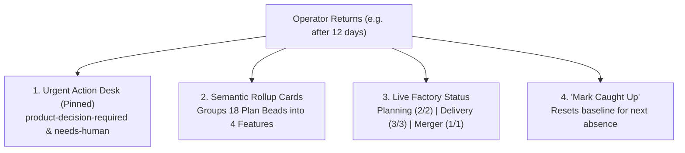
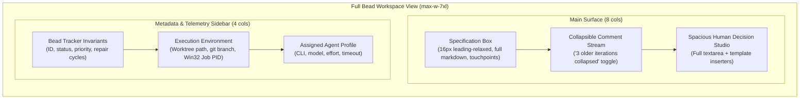

# Nightweaver UI Architecture: Synthesized Factory Console

Based on our design evaluation:
* **Variant C (Assembly Graph)** has been ruled out.
* The UI is designed as a **synthesis of Variant A (Factory Mission Control) and Variant B (Human Triage & Catch-Up Digest)**.
* **Core Mandate**: The UI serves as the **only human-friendly window into Beads (`bd`)**, the primary intake for submitting new Feature Requests, the intervention desk for unblocking agents (`product-decision-required`), and the monitoring station for the autonomous factory.

---

## 1. Architectural Solution: The "Since Last Visit" Dilemma

When a human operator logs in daily, a simple chronological activity feed works. But when logging in after **days or weeks**:
1. **The Problem**: A raw list of 30–60 closed Plan Beads and Git commits creates overwhelming cognitive noise and fatigue.
2. **The Solution: Milestone Rollups & Catch-Up Bookmarks**:
   * **Semantic Feature Rollups**: Completed Plan Beads are automatically grouped by their parent Product Bead (e.g. *Feature: Worktree Isolation Spine (4/4 Slices Merged &bull; PRs #41 #44)*).
   * **Explicit Delta Bookmark**: Displays `Last visited: 12 days ago (Oct 12)`.
   * **One-Click Catch-Up**: Clicking **"Mark Caught Up"** updates the operator's last-seen checkpoint to `now`, resetting the delta calculation for their next visit.
   * **Time-Horizon Selector**: The user can toggle between *Since Last Visit*, *Last 48 Hours*, *Last 7 Days*, or *All Time*.

---

## 2. Key Interface Modules

### 1. The Human Attention Desk (`product-decision-required` & `needs-human`)
* **Purpose**: Step in where human judgment is strictly required.
* **Inline Resolution Studio**:
  * For `product-decision-required`: Reads the Planner or Implementer Agent's question directly, provides an input box for guidance, and upon submission executes:
    1. `bd comments add <id> "<human-guidance>"`
    2. `bd update <id> --remove-label product-decision-required`
    3. Notifies the Orchestrator to auto-resume the agent in the appropriate pool slot.
  * For `needs-human`: Displays diagnostic logs, repair cycle count (`3/3`), and provides one-click actions (*Reset Budget & Retry*, *Copy Checkout Command*, *Abort & Close Bead*).
  * **Direct Deep Link**: Includes an explicit **"Open Full Bead Workspace ↗"** link to transition from shorthand triage into deep context analysis.

### 2. Product Bead Intake Composer (`+ New Feature / Bug`)
* **Purpose**: The primary human interface to submit new work.
* **Functionality**:
  * Modal composer supporting title, type (`feature` or `bug`), priority (`P0`–`P3`), and acceptance criteria.
  * Explicitly describes the autonomous lifecycle pipeline that will take over upon creation (Planning discovery $\to$ Drafting $\to$ Adversarial critique $\to$ Plan Bead materialization $\to$ Delivery).

### 3. Factory Execution Bays (Real-Time Observability)
* **Planning Pool Bay** (2 slots): Shows detached `HEAD` worktree analysis, active Planner/Challenger agents, and active plan backpressure gauge (`4/5`).
* **Delivery Floor** (3 slots): Shows isolated worktrees (`worktrees/<project>/<bead-id>`), branches (`nightweaver/<bead-id>`), and repair cycle badges (`↺ 0/3`).
* **Singleton Merger Air-Lock** (1 serial slot): Real-time tracking of rebase, conflict resolution, local test pass, and remote CI verification (`gh pr checks`).
* **Live Telemetry Drawer**: Clicking any active slot reveals simulated live `stdout`, Win32 Job Object PID, and process timeout timer.

### 4. Human-Friendly Beads Explorer
* **Purpose**: Single human-friendly window into all Beads stored in `.beads`.
* **Views**: Filterable tabs for *All*, *Active in Factory*, *Ready Backlog*, *Blocked Dependencies*, and *Closed / Merged*.
* **Interactive Navigation**: Clicking any table row opens that bead directly in the full-page workspace.

---

## 3. The Dedicated Full Bead Workspace

When digging deep into complex requirements or resolving tricky trade-offs, a compact 500px drawer is insufficient. The prototype features a full-surface **Bead Workspace View**:

### Key Workspace Features:
1. **Generous, Highly Readable Typography**:
   * Uses comfortable font sizing (`15px`–`16px` body text, `24px`–`30px` titles, `leading-relaxed` line-height).
   * Generous vertical margins and syntax-styled code blocks prevent cognitive fatigue when reading dense architectural specifications.
2. **History Compression & Smart Collapsing**:
   * Older planning drafts and adversarial challenge cycles are collapsed by default under a clean banner:
     `▸ 3 older iterations collapsed (Planning drafts & reviews) • Click to expand`
   * The **active halting event** (e.g. the Planner Agent's clarification question or QA failure diagnostic) remains prominently expanded and highlighted with an accent border.
   * A top toggle allows instantaneous *"Expand All"* or *"Collapse Older"*.
3. **Spacious Human Guidance Studio**:
   * Positioned directly below the decision stream so the operator has the complete context in view.
   * Includes one-click template inserters (e.g. *Option 1 (JWT)* vs *Option 2 (Session)*) and direct submission that unblocks the agent in `bd`.
4. **Runtime Telemetry Sidebar**:
   * Keeps isolated worktree paths, branch names, Git cleanliness invariants, and Win32 Job Object PID clearly visible alongside the spec.

---

## 4. Interactive Prototype

Test the updated full-workspace experience:
👉 [Open nightweaver_ui_prototype.html](file:///C:/Users/mgasp/.gemini/antigravity/brain/8ed8767a-cd2e-4e65-9944-8b4fb4407567/nightweaver_ui_prototype.html)
